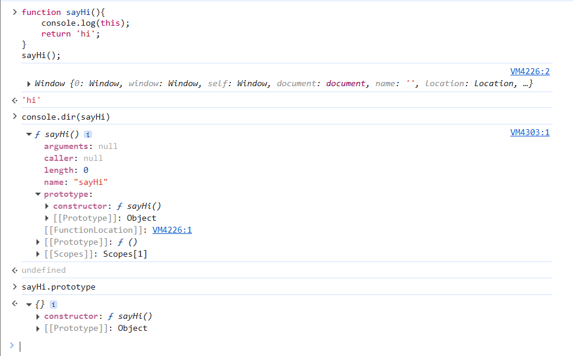
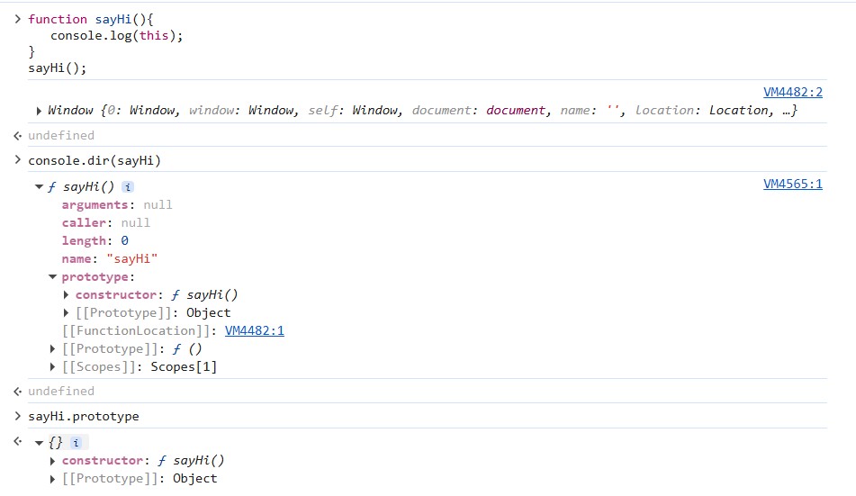
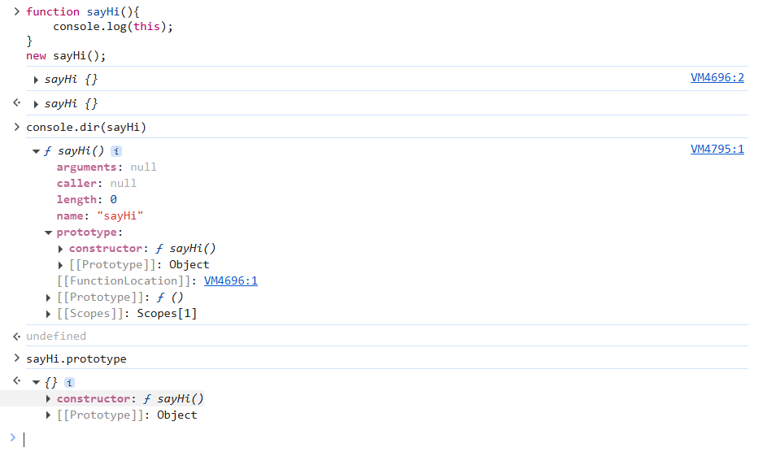
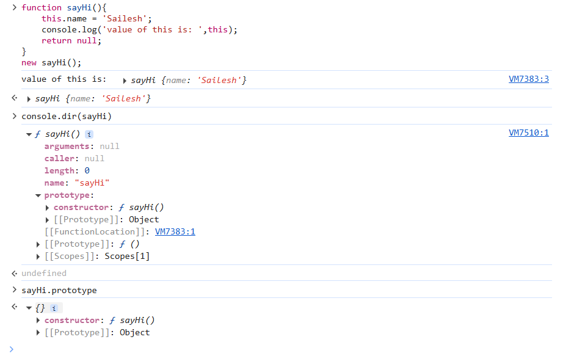
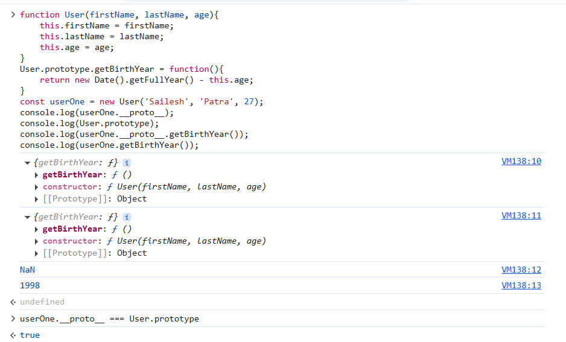

#### Version 1: Factory Function:
```
function createUser(firstName, lastName, age){
    return {
        firstName,
        lastName,
        age,
        getBirthYear(){
            return new Date().getFullYear() - user.age;
        }
    }
}
```
Demerit: Function duplication

#### Version 2: Solved function duplication using factory function only
```
function getBirthYear(){
    return new Date().getFullYear() - this.age; // **accesing age using this.**
}
function createUser(firstName, lastName, age){
    return {
        firstName,
        lastName,
        age,
        getBirthYear
    }
}
const userOne = createUser('Sailesh', 'Patra', 27);
const userTwo = createUser('Mamata', 'Patra', 47);
userOne.getBirthYear();
userTwo.getBirthYear();
userOne.getBirthYear == userTwo.getBirthYear; // true
```
Merit: We achieved polymorphism here, as getBirthYear has multiple forms based on the age variable of the user who called it.
Demerit: Encapsulation & Abstraction(Hiding implementation details) broke

#### Version 3:
```
function createUser(firstName, lastName, age){
    return {
        firstName, 
        lastName,
        age,
        getBirthYear: createUser.commonMethods.getBirthYear
    }
}
createUser.commonMethods = {
    getBirthYear(){
        return new Date().getFullYear() - this.age;
    }    
}
const userOne = createUser('Sailesh', 'Patra', 27);
const userTwo = createUser('Mamata', 'Patra', 47);
userOne.getBirthYear == userTwo.getBirthYear; // true
```
Version 3 fixed Abstraction. Encapsulation issue is still there.

#### Version 4: Prototypes

Before understanding prototype, let's dig into functions in JavaScript first and console.dir().

###### console.dir():
- is used to display an interactive list of the properties of a specified JavaScript object
- Unlike console.log(), which prints the object as a string, console.dir() shows the object as a tree structure that can be expanded and collapsed (especially in browser dev tools).

##### Functions:
Analyze the return types of following snippets:
###### Snippet-1
```
function sayHi(){
    console.log(this);
    return 'hi';
}
sayHi();
```
output:

###### Snippet-2
```
function sayHi(){
   console.log(this);
}
sayHi();

```


###### Snippet-3
```
function sayHi(){
    console.log(this);
}
new sayHi();
```


###### Snippet-4
```
function sayHi(){
    this.name = 'Sailesh';
    console.log('value of this is: ',this);
    return null;
}
new sayHi();
```


Let's analyze the snippets:
1. Return type:
- In snippet-1 we returned hi, so it retruned the same string hi
- In snippet-2, we didn't return anything, so it shows undefined in devtools
- In snippet-3, when called using new keyword, even though we didn't return anything, it shows an empty object
- In snippet-4, it returned the object with name property, even though we returned null.
2. this:
- In snippet-1, this points to window object
- In snippet-2, this points to window object
- In snippet-3, when called function using new keyword, this points to an empty object
- In snippet-4, when called function using new keyword, this points to an empty object and shows property we assigned in this
3. constructor:
- In all snippets, the function has a function named constructor in its prototype.

#### What happens when a function is called using new keyword?
- All functions in JavaScript has a property named `constructor` which is a function and and it's available in prototype property of function.
- This `constructor` is only called, when we call the function using new keyword.
- when called with new:
    - Creating an empty object
    - assigning this to the new object
    - calls the constructor function
    - returns this new object created no matter you have returned anything from function or not. and you'll see function as a label on returned value.
- when the function is called using new, it's called a `constructor function`. If called without new, its a normal function only.

#### Prototypal Inheritance:
Let say we want to create a User class. User class consists of properties & functions associated with the User.
While attaching functions to a constructor function, we attach to the prototype property of the `constructor function`

example:
```
function User(firstName, lastName, age){
    this.firstName = firstName;
    this.lastName = lastName;
    this.age = age;
}
User.prototype.getBirthYear = function(){
    return new Date().getFullYear() - this.age;
}
const userOne = new User('Sailesh', 'Patra', 27);
console.log(userOne.__proto__);
console.log(User.prototype);
console.log(userOne.__proto__.getBirthYear());
console.log(userOne.getBirthYear());
```
Output:


Analyzing above snippet:
- Functions attached to prototype property of constructor function, will be available in `__proto__` property of each instance/object created from that `constructor function`.
- If any property is available in `__proto__`, we can call it directly on the object using dot[.] property.
- `userOne.__proto__.getBirthYear()` is NaN, because, `userOne.__proto__.getBirthYear()` is User.prototype.getBirthYear() and User.age is undefined, becuase User is a class and not an object of that class.