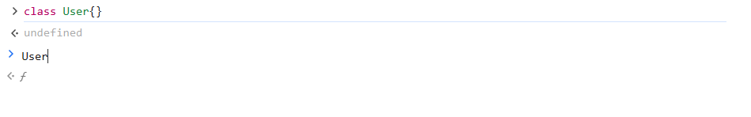
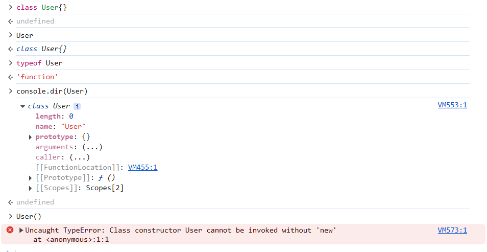
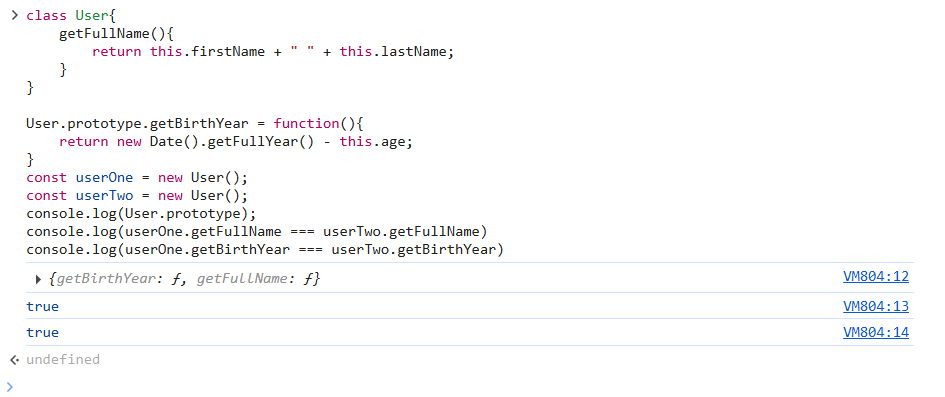

- Classes in JavaScript works same as Constructor function. It's just a syntactical sugar on top of it.

##### Snippet1:
```
class User{
    
}
```


In above snippet, I have type User in console and not entered and it shows function symbol


- After entering, function symbol changed to class.
- typeof User says it's of function type.
- On checking console.dir of User, there's a property named `FunctionLocation`, even though its a class.
- Calling User() without new keyword throws error. But it was possible in `constructor function` syntax.
- Hence class is a function behind the scenes. As mentioned earlier it's just a syntactic sugar over functions syntax.

##### In constructor functions we're adding functions using prototype, can we do that in classes? yes
```
class User{
    getFullName(){
        return this.firstName + " " + this.lastName;
    }
}

User.prototype.getBirthYear = function(){
    return new Date().getFullYear() - this.age;
}
const userOne = new User();
const userTwo = new User();
console.log(User.prototype);
console.log(userOne.getFullName === userTwo.getFullName)
console.log(userOne.getBirthYear === userTwo.getBirthYear)
```


As shown above:
- No matter how you add the function, using prototype or from inside of class, it will be part of class's prototype. Both works the same behind the same.
- Both user instance's point to same function location in memory. Hence no duplication of functions.

##### When functions were called using new, it was doing 3 things:
- Creates an empty object
- Points this to the new empty object
- Calls the constructor function.

But in class we can mention our own constructor function and pass params to initialize an instance of that class and is called when we create an object of that class using new keyword.

Rules:
- In class also new works the same and creates and returns a new object.
- You can not write any instruction just inside the class. It should be wrapped inside a function.

```
class CreateUser {

  isHuman = true; // Public variable
  #userSecret = 'sxcsd'; // private variable

  constructor(firstName, lastName, age) {
    this.firstName = firstName
    this.lastName = lastName
    this.age = age
  }

  getBirthYear() {
    return new Date().getFullYear() - this.age
  }
  getFullName() {
    return this.firstName + ' ' + this.lastName
  }
}

const user1 = new CreateUser('Aman', 'Mishra', 32)
const user2 = new CreateUser('Anurag', 'Singh', 72)
```

#### What is allowed in JS Classes
```
class Person {
  name = "Alice"; // ✅ Public field (instance variable)
  
  constructor(age) {
    this.age = age;
    console.log("Constructor works!"); // ✅ Logging in constructor is allowed
  }

  greet() {
    console.log(`Hello, I am ${this.name}`); // ✅ Regular method
  }

  static sayHi() {
    console.log("Hi from static method!"); // ✅ Static method
  }
}
```

#### What isn't allowed in JS Classes
```
class BadExample {
  console.log("Hey!"); // ❌ SyntaxError
  const x = 10;        // ❌ SyntaxError
  if (true) {}         // ❌ SyntaxError
}

```

#### Where can you use console logs in JS Classes:
```
class MyClass {
  name = "Example"; // ✅ allowed

  constructor() {
    console.log("Inside constructor"); // ✅ allowed
  }

  showName() {
    console.log(this.name); // ✅ allowed
  }

  static sayHello() {
    console.log("Hello from static"); // ✅ allowed
  }
}

```