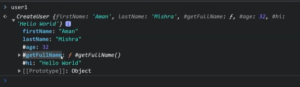

### Problem: To keep private variables in a class

```
class CreateUser {
  constructor(firstName, lastName, age, secret) {
    this.firstName = firstName
    this.lastName = lastName
    this.age = age
    this.secret = secret
  }

  getBirthYear() {
    return new Date().getFullYear() - this.age
  }
  getFullName() {
    return this.firstName + ' ' + this.lastName
  }
}

const user1 = new CreateUser('Aman', 'Mishra', 32,'dhcjdfjdf')
const user2 = new CreateUser('Anurag', 'Singh', 72, 'dsckjsd')

console.log(user1.secret);
user1.secret = 'updated_secret';
```

Here I can access & even modify the secret variable outside the class. 

What If I want to make it private?
Previously there were no way in JS. It'sintroduced late in JS to make variables private in a class.

Earlier, people use double underscore before variable names to distinguish it's private. But you can access & modify.

Now the feature is available for use. To make any variable private use "#" before variable name.

- To access a private variable inside a constructor, you need to define it outside the class, like below:
```
class User{
    #age // private dynamic variable, get its value from constructor
    hi = 'hellow world'; // public variable
    #hiPrivate = 'hi'; // private constant variable, same for all instances

    constructor(firstName, lastName, age){
        this.#age = age;
        this.firstName = firstName;
        this.lastName = lastName;
    }

    getBirthYear(){
        return new Date().getFullYear() - this.#age; // Use with # inside the class as well.
    }
    
    #getFullName(){
        return this.firstName + " " + this.lastName;
    }
}
const user1 = new User(20);
user1.age; //undefined
user1["#age"] // error
user1.#age; // Erorr: Uncaught syntax error: Private field '#age' must be declared in an enclosing class
user1.getBirthYear(); // Valid value.
```



#### Private properties of class is not shown under prototypes in above pic.

```
class User{
    #age // private dynamic variable, get its value from constructor
    hi = 'hellow world'; // public variable
    #hiPrivate = 'hi'; // private constant variable, same for all instances

    constructor(firstName, lastName, age){
        this.#age = age;
        this.firstName = firstName;
        this.lastName = lastName;
    }

    getBirthYear(){
        this.#getFullName()
        return new Date().getFullYear() - this.#age; // Use with # inside the class as well.
    }
    
    #getFullName(){
        return this.firstName + " " + this.lastName;
    }
}
const user1 = new User(20);
user1.getFullName(); // error
user1.#getFullName(); // error
getFullname can be called inside getBirthYear inside the class.
```

Can we create private variables in Object literals? No
```
const a = {
    'name': 'Sailesh',
    '#age': 34
}
a.age // undefined
a.#age // error, Uncaught syntax error: Private field '#age' must be declared in an enclosing class

But
a['#age'] --> // able to access

```
Hence private variables in objects literal is not available.