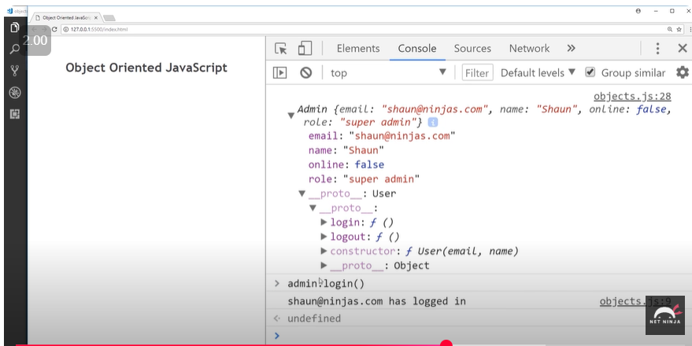

In one of previous lectures, we created an `Admin` class from `User` class using `Class` keyword.

We'll do the same using `Constructor functions` here.

This can be achieved using Function borrowing concept of JavaScript.

```
function User(email, name){
    this.email = email;
    this.name = name;
    this.online = false;
}

User.prototype.login = function(){
    this.online = true;
    console.log(this.email, 'has logged in');
};

User.prototype.logout = function(){
    this.online = false;
    console.log(this.email, 'has logged out');
};

function Admin(...args){
    User.apply(this, args);
}

Admin.prototype = Object.create(User.prototype);

Admin.prototype.deleteUser = function(u){
    users = users.filter(user => {
        return user.email != u.email;
    });
};

var userOne = new User('ryu@ninjas.com', 'Ryu');
var userTwo = new User('yoshi@mariokorp.com', 'Yoshi');
var admin = new Admin('shaun@ninjas.com', 'Shaun');

var users = [userOne, userTwo, admin];
```

- `Admin` atlast is a user. Hence when we create a instance of Admin using new, it also should execute the constructor method and initialize the properties of `User`.
- We did the same using `apply()` in JavaScript.
- We created an instance of `Admin` using new, which we stored in `admin` variable.
- `admin` variable hold the reference to new object created in memory by `new` keyword.
- When `User.apply` is called, it will run the snippet mentioned in constructor of `User` class. When `this.email` is ran in constructor, `this` should point to the new empty object reference stored in `admin` variable.
- As we already know, inside the class Admin, wherever I call this, it will also refer to the empty object created. So we passed it inside `User.apply`.
- We're inheriting `Admin` from a different class and If `User` is taking 15 args, I had to pass all those manually by typing it all. The solution is to use spread operator syntax.
- Similarly, User class might have hundreds of functions. So instead of:
    ```
    Admin.prototype.login = User.prototype.login;
    Admin.prototype.logout = User.prototype.logout;
    ```

    do below:
    ```
    Admin.prototype = Object.create(User.prototype);
    ```

In console If you'll log Admin user instance, the `__proto__` of admin user instance will point to `User` class. and login and logout won't be inside `__proto__` of Admin class directly. It will be available at 2 nested level from Admin.
AdminUser instance's prototype will User. User's prototype will have login & logout


If we're adding `deleteUser` in `Admin` class, deleteUser will be part of Admin's proto, at one nested level though.

No matter how many nested level you have the functions, while calling the functions on admin instance, there won't be any change in syntax. This is because of Prototype chaining. When we try to access a property from a object, it will look for the property in the whole prototype chain, until `__proto__` is null in the chain.

```
const admin = new Admin('sailesh@gmail.com', 'sailesh');
admin.login(); // at 1 nested level
admin.deleteUser(userOne); // att 2 nested level
```

Admin class chain will look like:
`Admin.__proto__` is `User`
`User.__proto__` is `Object`
`Object.__proto__` will be `null`

### Important Note:
1. Here objects of `Admin` class can access methods available in `User` class. Reason: Admin's prototype is pointing to User class.
2. Similary, "Everything in JavaScript is an Object". console.log an array or function or any other datatype. Array's or function's prototype chain conatins `Object` at some nesting level. Hence you can call methods/properties of `Objects` on `Arrays` or `Functions` as well. But it's not appropriate to do that.

### Here's what chatgpt has to say: 
###### Qs: As arrays has the prototypes of objects, can I call all methods that can be called on an object, on array also?
Great question — and you're absolutely right that **arrays inherit from `Object.prototype`**, so they technically have access to many of the same methods. But there’s a subtle catch:

### ✅ You *can* call most `Object.prototype` methods on arrays...
Because arrays are objects under the hood (`typeof [] === "object"`), they inherit from `Object.prototype`. So methods like these are accessible:

- `hasOwnProperty()`
- `toString()` *(though it's overridden by `Array.prototype.toString`)*
- `valueOf()`
- `propertyIsEnumerable()`

#### Example:
```javascript
const arr = [1, 2, 3];

console.log(arr.hasOwnProperty("1")); // true
console.log(arr.toString());          // "1,2,3" (overridden by Array prototype)
```

### ❌ But not *all* object methods work the same on arrays
Some methods or behaviors are:

1. **Overridden**: Arrays have their own versions of `toString()`, `valueOf()`, etc.
2. **Not meaningful** for arrays: For example, `Object.assign()` works, but copying arrays this way isn’t idiomatic.
3. **Confusing or lossy**: Methods like `Object.keys()` return the indices as strings (`["0", "1", "2"]`) instead of values.

#### Example:
```javascript
const arr = ["a", "b"];
console.log(Object.keys(arr)); // ["0", "1"]
```

### Summary:
- ✅ Yes, you can access `Object.prototype` methods on arrays.
- ⚠️ But that doesn’t mean it’s *appropriate* or *useful* in all cases.
- 🚫 Array-specific logic (like looping, element access, transformation) should usually use array methods.