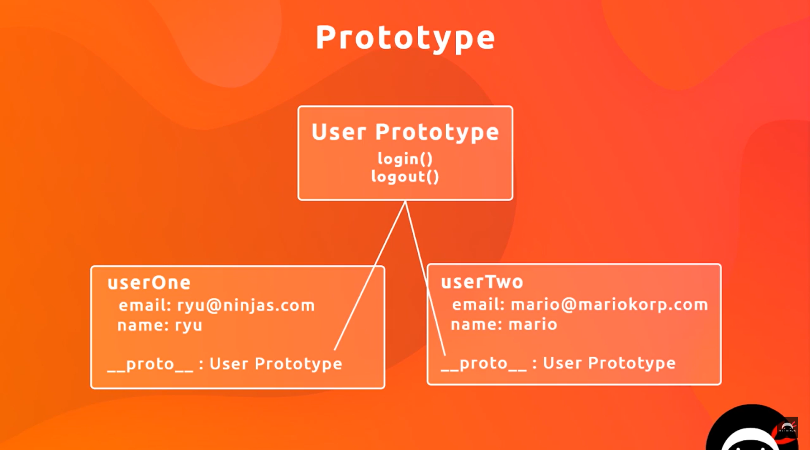

- classes in javascript are a thin layer of abstraction over prototypes.
- with class keyword also, javascript classes work the same way as before with prototypes.
- Let's see how we're creating classes before:
    - Constructor functions

### Constructor functions:
- In constructor functions, there must be some way to achive what a constructor function does in classes.
- When a normal function is called with new keyWord, that becomes a constructor function. example: `new User()`
- Let's see how we can do that in constructor function. 
- Syntax: 
    - function keyword, followed by name of class with first letter as capital
    - Objects from constructor functions can be created using the same syntax that we used for classes using new keyword
        - var userOne = new User('ryu@ninja.com', 'ryu');
    - new keywords does the same 3 things that it does in es6 classes as well
        - Creating an empty object
        - assigning this to the new object
        - calls the constructor function


```
function User(email, name){
    this.email = email;
    this.name = name;
    this.online = false;
    this.login = function(){
        console.log(this.email, 'has logged in');
    }
    this.logout = function(){
        console.log(this.email, 'has logged out');
    }
}
var userOne = new User('ryu@ninja.com', 'ryu');
console.log(userOne);
userOne.login();
```
### What's demerit of above?
- For each object of User class, it will have it's own login function. It's creating duplication. The functionality of login is same for all user instances, so no point of creating the same function every time we instantiate a user class.
    ```
    console.log(userOne.login === userTwo.login) // false
    solution: Adding functions using prototype
    But If we do the same on two array functions like below:
    const a = [1,2]
    const b = [3,4]
    console.log(a.pop === b.pop) // true
    ```
- Even though everything is working fine. We're able access properties & methods without any issue. In console we're able to see all its properties & methods; there's one minor improvement we need to follow the right way of doing things.

- In constructor function syntax, when we create classes, we don't generally put methods inside the class. But we attach the methods to classes using prototype property.

## Lecture 10. Prototype:
If you check the console.log an array and check in devtools, you'll find all methods of an array available under `__proto__` property.

In modern browsers, `__proto__` is shown as `[[Prototype]]` in devtools

But while calling a method on array we don't call it like:
`[].__proto__.sort()`.

But we can directly call `[].sort()`

In code example of last lecture, If you console the user object, you'll find the login & logout functions at root level, as they're directly mentioned inside the constructor function.

If you attach using protottypes, it will behave the same like inbuilt array types in JS. Methds will be available under `__proto__` can be accessed using dot property without `__proto__`

```
function User(email, name){
    this.email = email;
    this.name = name;
    this.online = false;
}

User.prototype.login = function(){
    this.online = true;
    console.log(this.email, 'has logged in');
};

User.prototype.logout = function(){
    this.online = false;
    console.log(this.email, 'has logged out');
};

var userOne = new User('ryu@ninjas.com', 'Ryu');
var userTwo = new User('yoshi@mariokorp.com', 'Yoshi');

console.log(userOne); 
userTwo.login();
```

In above example, you'll find `__proto__` in user objects in console and all methods inside there.

### Merit of adding methods using Prototypes:


Every object type has a proto type. Now what comes under object types(date, array, function etc)

In the image above it shows, how login & logout functions are just defined once in memory and all instances of user class will borrow those methods from User prototype.

The user instance has `__proto__` property that links to the `User Prototype.`

To add a function to `__proto__` property of User class, we need attach it to User class(& not user object/instance) using `User.prototype.functionName = function(){}`

Note:
All above things happens behind the scenes when you create class using `Class` keyword.