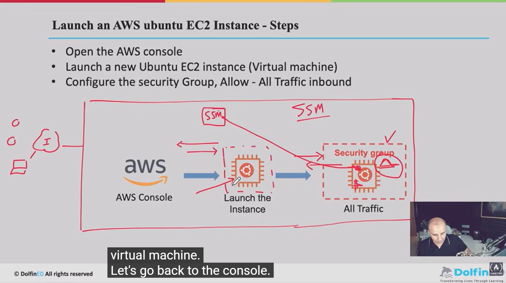

Learn Docker – Full DevOps Course for Deploying Containerized Apps
https://www.youtube.com/watch?v=rjjES5IsPdg&t=11049s

1. Sign up:
    1.1. "Root user email address": For all communications, billing details etc
    1.2 AWS Account name
    1.3 Security Captcha verification
    1.4 Configure "Root User PWD"
    1.5 Choose Free Plan
    1.6 Enter personal details: name, phone#, address
    1.7 Enter Credit Card Info
    1.8 3 ways of verification: 1. Email, 2. Phone# 3. Credit Card
    1.9 Confirm your identity (After AWS Captures all 3 verification method, this step is to validate your identity against your phone/creditcard/email)
    2.0 Another Captcha and code received on phone
    2.1 Choose a Support plan: Choose the free plan option here
    2.2 You can open your aws console dashboard now.

2. Explore Different Services available on AWS Console: 
    2.1 VPC
    2.2 Regions
    2.3 EC2:

        2.3.1 Choose instance type wisely, as it has cost associated with it.
        2.3.2. How to launch an EC2 instance or Virtual Machine:
            2.3.2.1. Enter a custom name for the instance you want to create.
            2.3.2.2 Choose OS you want to install on the VM
            2.3.2.3 Any VM has a V-neck like vCPU (Virtual CPU), vMemory, vDisk. From the "instance type" option you can select the vNeck for your VM.
            2.3.2.4 Key-Pair login: If you want to access the instance remotely, then you have to create a Key-Pair
            2.3.2.5 Network Settings:
                2.3.3.6 Choose VPC: Which VPC will the VM land on
                2.3.3.7 Choose Firewall (Security Groups): Do you want to allow traffic from outside the VPC or from internet?
    2.4 IAM Service:

        2.4.1 Create an IAM user with lesser privilleges, instead of using root user, which is the most powerful user with all previlleges. 
        2.4.2 How to create an IAM user?
            2.4.2.1 Go to IAM service from AWS console dashboard
            2.4.2.2 Create User
            2.4.2.3 Fill in the form
                0. Specify User details
                    2.4.2.4 Username
                    2.4.2.5 Provide user access to AWS Console
                    2.4.2.6 Create a custom pwd for IAM user
                1. Set Permissions
                    For this demo, we selected Attach Policies Directly and from Permission policies detail, added Adminstrator Access. -> This is not recommended from AWS. It's okay for docker course though.
                2. Review and Create
                3. Retrieve PWD: Download & Save the PWD csv file or send it to your email.
        2.4.3 Logout and Sign in to console using IAM userid and pwd.
        2.4.4 For the first time when you login using IAM pwd, it will prompt you to change the IAM pwd again here. Save the updated pwd again.
    2.5 Launch an AWS EC2 - Ubuntu Linux Instance:

        2.5.1 We'll be using this instance for all next practice sessions throughout the docker course.
        2.5.2 Why UBUNTU Linux? Becuase it's free. other versiosn of Linux like redhat linux or amazon linux is not free and has cost associated.
        2.5.3 Steps to Launch AWS Ubuntu EC2 Instance: Timestamp: 01:30:52
            0. Step:0 - Create a SSM role
            1. Step:1 - Open the AWS Console dashboard
            2. Step:2 - Select a nearest region before creating an instance
            3. Step:3 - Launch a new Ubuntu EC2 Instance (Vitrual Machine)
            4. Configure the security group/Firewall, All all traffic inbound for this docker course. As our focus is learning docker and it's not AWS Course.
        2.5.4 Timestamp: 01.31.07: Let's complete these steps now:
            Step-0: Create a SSM role:
                1. Create a role from IAM service:
                    1. Select trusted entity
                    2. Add permissions
                    3. Name, review and create
                2. SSM:
                    
            Step-1: Select nearest region: Hyd or Mumbai
                Next time when you login, the default region might be different. Make sure you switch to regio where you created your instance. If you're in other regions, you won't see the EC2 instanc, If you've created in a specific region

                Selecting nearest region will help you save cost and credit from your billing account.
            Step-2 Launch Instance:
                1. Name of VM: Docker-Host
                2. Select OS: Ubuntu Linux
                3. Choose Instance type: t2.micro
                4. Create keypair: For SSH login to your VM, Download the pem file after creating the key pair.
                5. Network Setting:
                    1. Choose any of the subnets. all are same.
                    2. Create Security Group/Firewall:
                        Name: Docker-SG
                        Inbound Security Group rules:
                            Type: "All Traffic"
                            SourceType: "Anywhere"
                6. Configure Storage:
                    Keep default values: 8GiB
                6.1 You cana assign IAM role from collapsed Advanced Details options:
                    Select IAM Instance Profile. or else follow pt. 8 to assign IAM role post launch of EC2.
                7. Launch Instance
                    1. Check the Public and Private IP
                8. Assign IAM role (SSM) created
                    1. Go to instances under EC2 Service
                    2. At top nav bar, Go to Actions -> Security -> Modify IAM role.
                    3. Select the role and update.

SSM role:
                   
                
#### <u>Timestamp: 01:50:05: Use AWS SSM to connect to the Ubuntu EC2 Instance on AWS: </u>

