# What are different type of diagrams in RDBMS? When to use which one?

In **RDBMS/database design**, different diagrams are used at different stages—from understanding the business requirements to designing tables and finally understanding how queries execute.

A useful way to think about them is:

> **Requirements → Conceptual Design → Logical Design → Physical Design → Query/Execution Understanding**

### 1. ER Diagram (ERD) — *Conceptual database design*

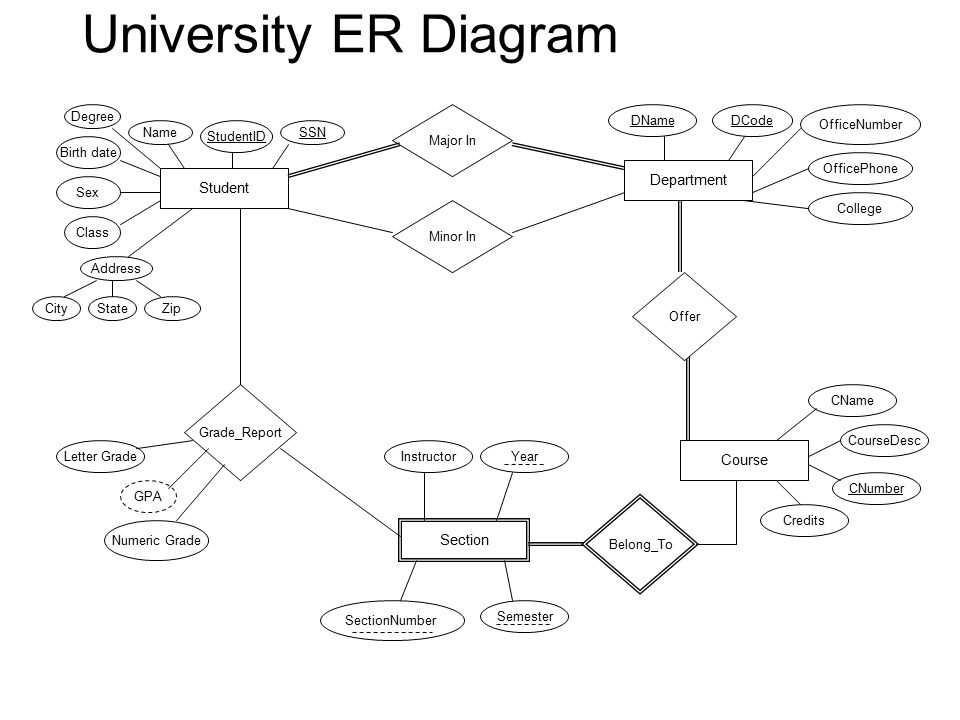

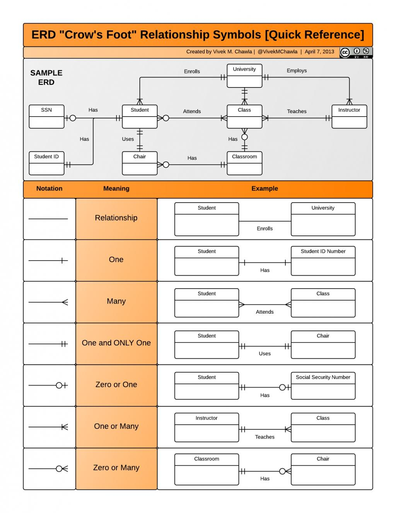

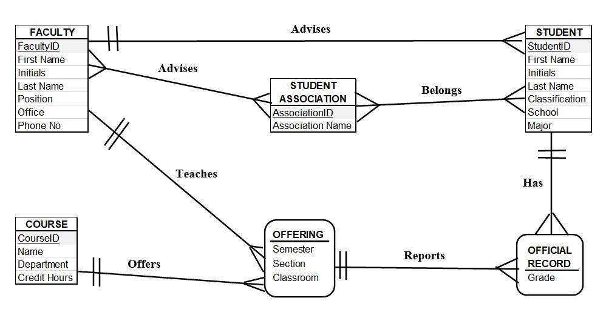


An **ER Diagram** represents:

* **Entities** → `Student`, `Course`, `Teacher`
* **Attributes** → `student_id`, `name`, `email`
* **Relationships** → Student *enrolls in* Course
* **Cardinality** → 1:1, 1:N, M:N
* **Keys** → Primary/foreign keys, depending on notation

Example:

```text
STUDENT                    COURSE
---------                  ---------
student_id (PK)            course_id (PK)
name                       name
email                      credits
      \                       /
       \     ENROLLS IN      /
        \                   /
         ----<           >----
```

**Use when:**
You are designing a database from business requirements and want to understand **what data exists and how it relates**.

---

### 2. Relational Schema Diagram — *Logical database design*

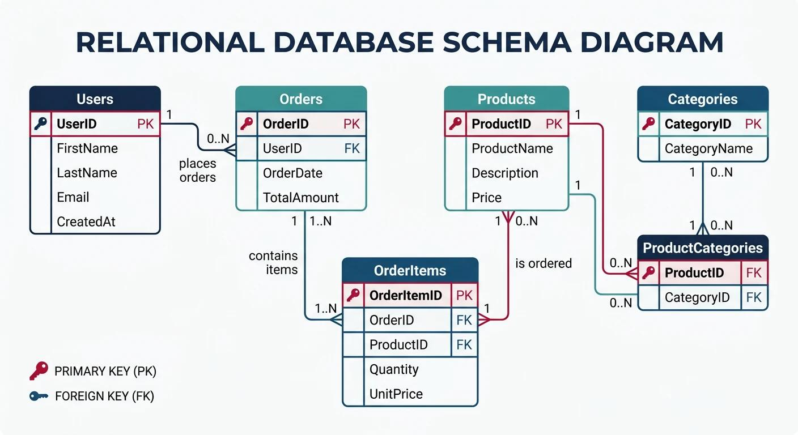

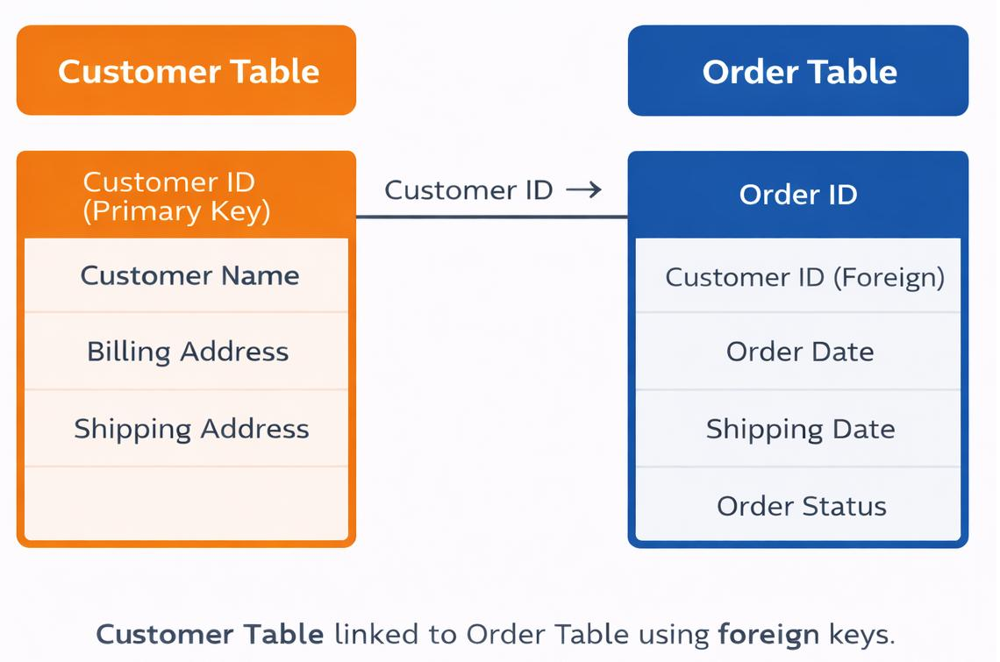

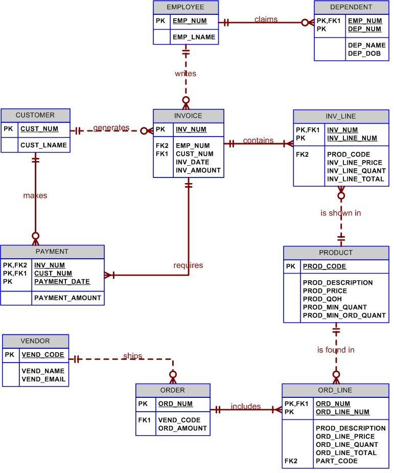


This is closer to the actual relational database.

It represents **tables, columns, PKs and FKs**.

```text
STUDENT
----------------
PK student_id
   name
   email

ENROLLMENT
----------------
PK student_id  ─────┐
PK course_id        │
   enrolled_at      │
                    │
COURSE              │
----------------    │
PK course_id <──────┘
   name
```

It answers:

> **"How will my conceptual model become relational tables?"**

**Use when:**
Designing the actual relational schema before implementing it in MySQL/PostgreSQL/etc.

---

### 3. Database Schema Diagram — *Overall database structure*

This is often used interchangeably with a **relational schema diagram**, but in practice it can be broader.

For example:

```text
users
  │
  ├──── orders
  │       │
  │       └──── order_items
  │                    │
  │                    └──── products
  │
  └──── addresses
```

It gives you a **bird's-eye view of the database**.

**Use when:**
You want to understand or communicate the structure of an existing database with many tables.

> **ERD vs Schema Diagram:** ERD focuses more on the **conceptual model and relationships**; a schema diagram focuses more on the **implemented relational tables**.

---

### 4. UML Class Diagram — *Object-oriented application design*

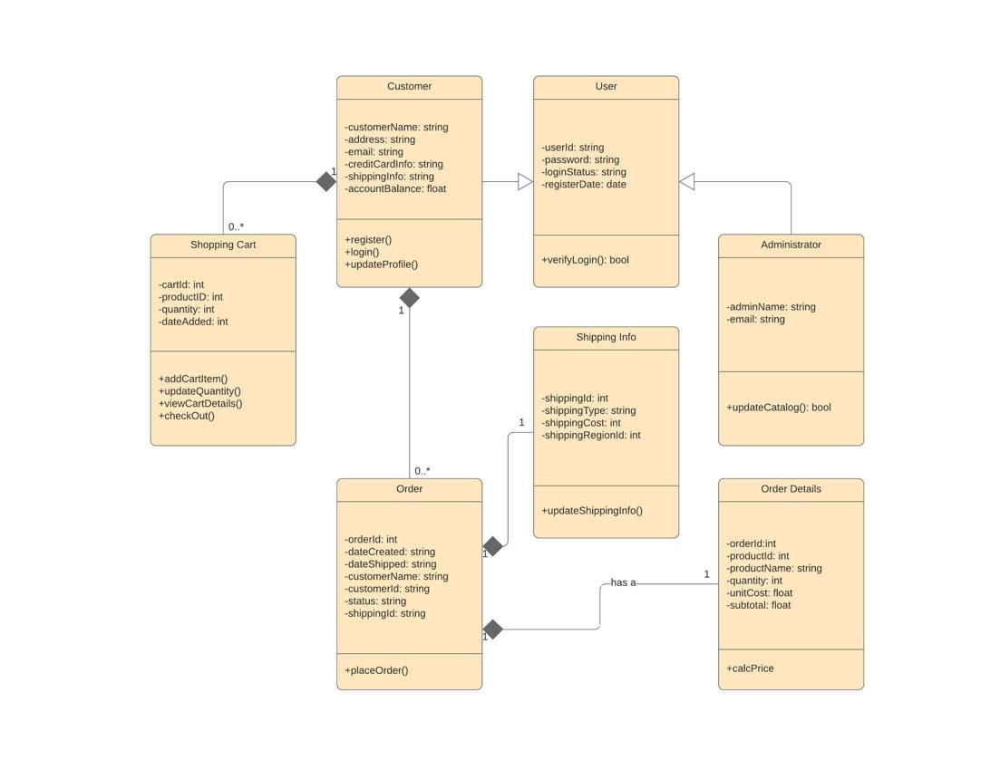

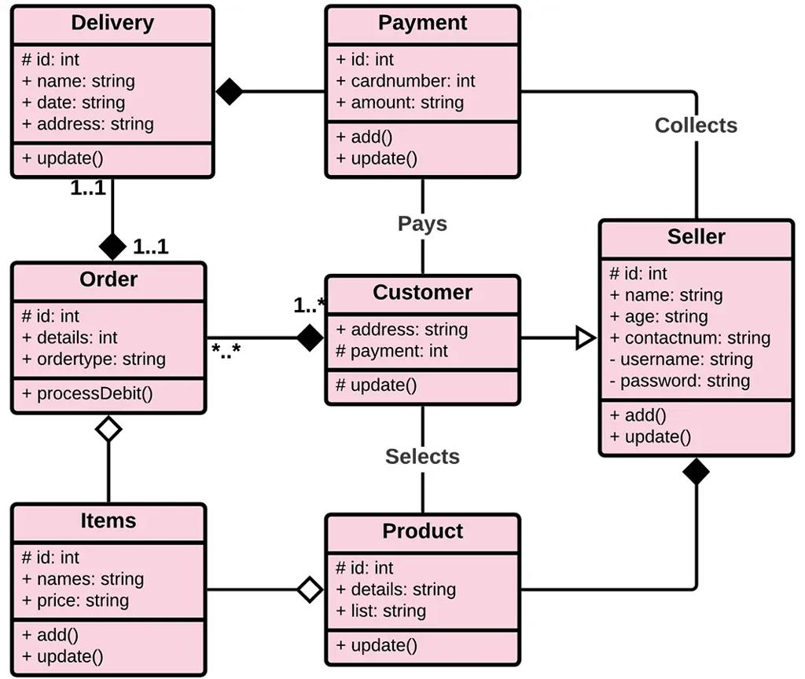

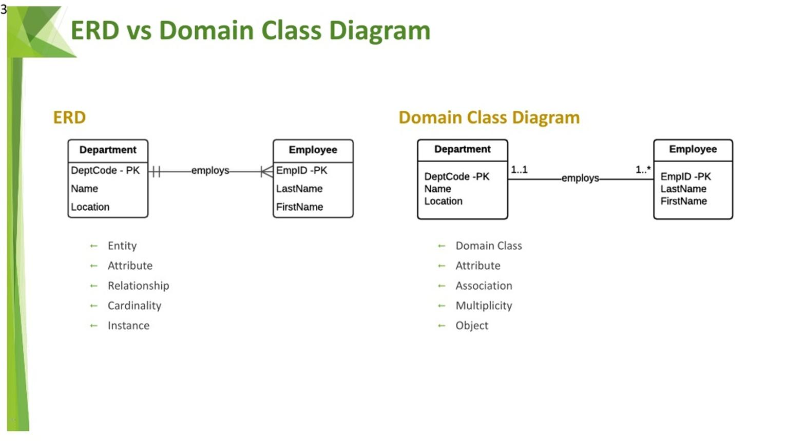


A UML Class Diagram represents **classes and their relationships**, rather than specifically database tables.

```text
+----------------+
|     User       |
+----------------+
| - id           |
| - name         |
| - email        |
+----------------+
| + login()      |
| + logout()     |
+----------------+
         |
         | places
         | 1..*
         ↓
+----------------+
|     Order      |
+----------------+
| - id           |
| - amount       |
+----------------+
| + cancel()     |
+----------------+
```

Notice that it can contain **behavior/methods**, something an ERD doesn't normally model.

**Use when:**
Designing the **application's object model**, especially with Java, C++, C#, etc.

---

### 5. UML Object Diagram — *Snapshot of actual objects/data*

An Object Diagram is like a **snapshot of instances of classes at a particular point in time**.

```text
user1 : User
----------------
id = 101
name = "Sailesh"

order1 : Order
----------------
id = 5001
amount = 2500

user1 ───── places ─────> order1
```

**Use when:**
You want to demonstrate what actual objects/data look like at a particular moment.

It's **not commonly used for designing RDBMS schemas**.

---

### 6. UML Sequence Diagram — *How application interacts with DB*

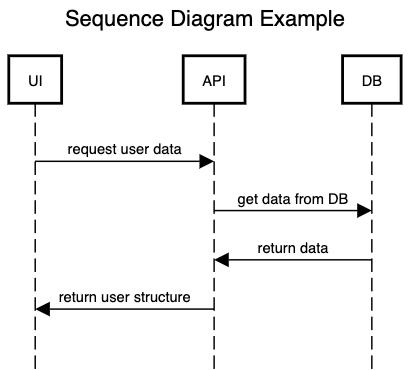

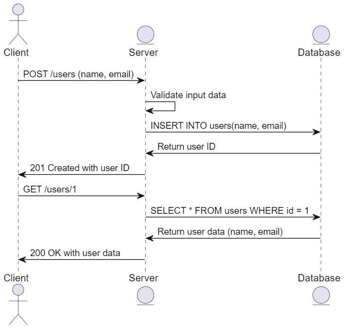

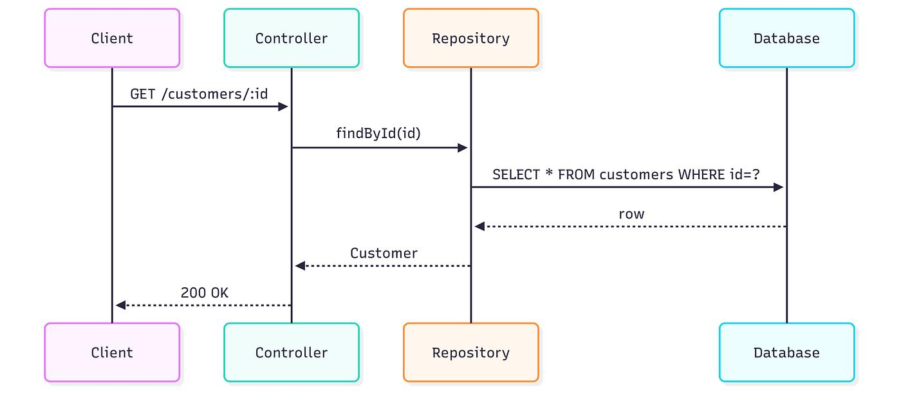


This shows **time/order of interactions**.

For example, when a user logs in:

```text
User       API        Database
 │          │             │
 │ Login    │             │
 ├─────────>│             │
 │          │ SELECT      │
 │          ├────────────>│
 │          │             │
 │          │ User found  │
 │          │<────────────┤
 │  Token   │             │
 │<─────────┤             │
```

**Use when:**
Understanding **how your application, APIs and database interact**.

---

### 7. Data Flow Diagram (DFD) — *How data moves*

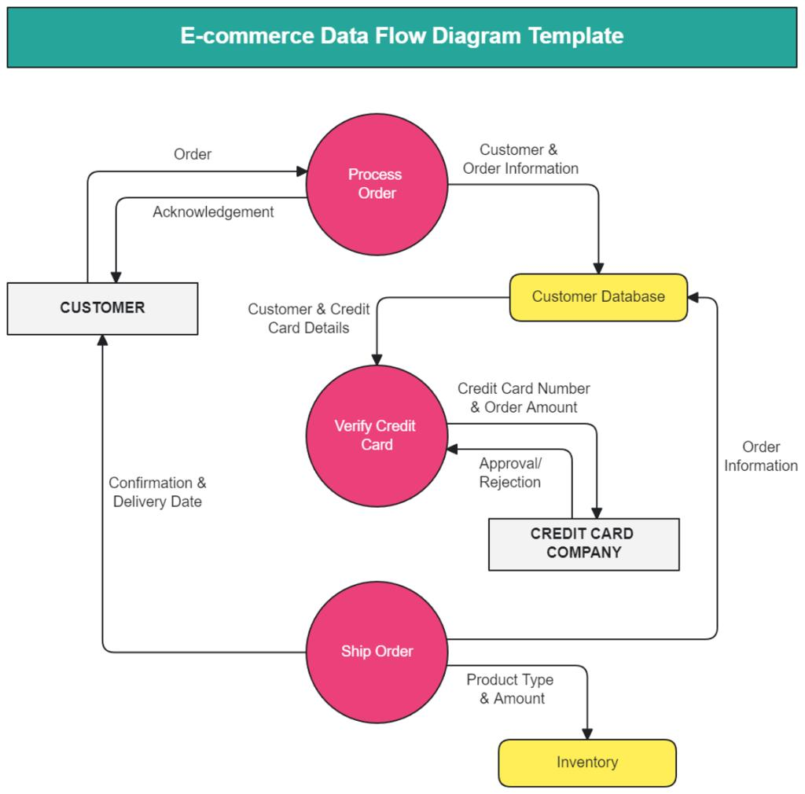

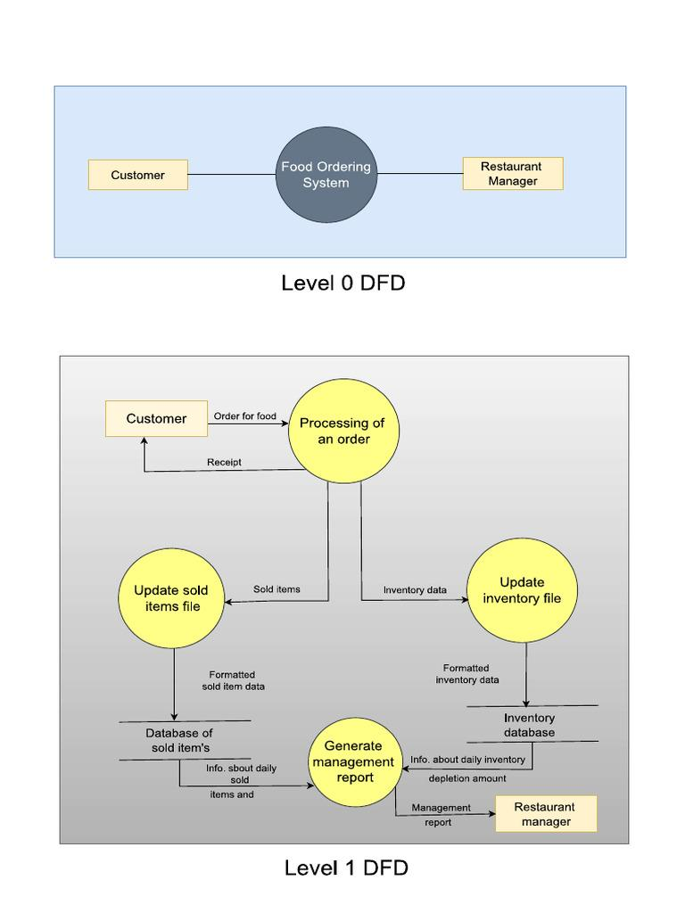

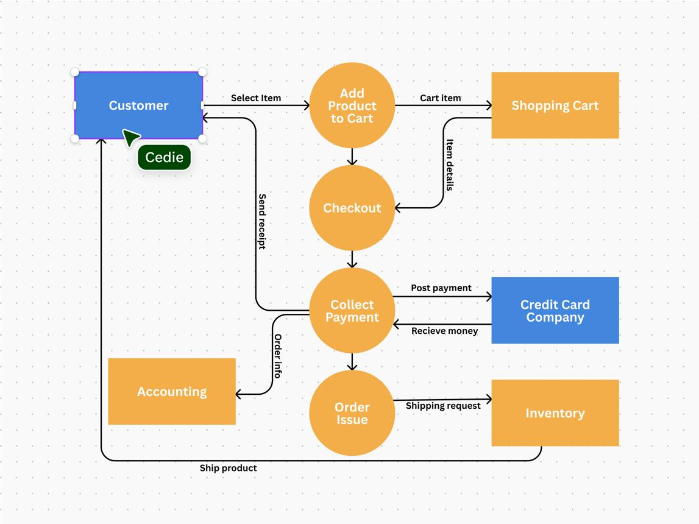


A DFD focuses on **movement of data**, not database structure.

```text
Customer
   │
   │ Order details
   ↓
Order Service
   │
   │ Store order
   ↓
Database
```

It answers:

> **"Where does data come from, where does it go, and how is it transformed?"**

**Use when:**
Analyzing system requirements and data movement before designing the database.

---

### 8. Database/Query Execution Diagram — *How a query is executed*

This isn't a standard "database modeling diagram" like ERD, but diagrams are often used to explain query execution.

For example:

```text
SQL Query
   ↓
Parser
   ↓
Query Optimizer
   ↓
Execution Plan
   ↓
Index Scan / Table Scan
   ↓
Buffer Pool
   ↓
Disk
```

**Use when:**
Learning or troubleshooting **database internals, query performance, indexing, execution plans**, etc.

---

## Putting them together

Suppose you're building an **e-commerce system**.

You might use the diagrams in this order:

```text
                 BUSINESS REQUIREMENTS
                         │
                         ↓
                  ┌─────────────┐
                  │    DFD      │
                  │ Data flows  │
                  └──────┬──────┘
                         ↓
                  ┌─────────────┐
                  │    ERD      │
                  │   Entities  │
                  │ Relationships│
                  └──────┬──────┘
                         ↓
              ┌─────────────────────┐
              │ Relational Schema   │
              │ Tables + PK + FK    │
              └──────────┬──────────┘
                         ↓
                  ┌─────────────┐
                  │   Physical  │
                  │   Database  │
                  └─────────────┘
                         ↓
                  SQL / Queries
                         │
                         ↓
              Execution Plan / Query
                 Execution Diagram
```

Meanwhile, if you're designing the **application itself**, you may use UML:

```text
UML Class Diagram
        ↓
Application objects/classes
        ↓
UML Sequence Diagram
        ↓
API ↔ Service ↔ Database interaction
```

---

## Quick comparison

| Diagram                       | Main purpose               | Focus                        | When to use                         |
| ----------------------------- | -------------------------- | ---------------------------- | ----------------------------------- |
| **ER Diagram (ERD)**          | Model data                 | Entities & relationships     | **Designing database conceptually** |
| **Relational Schema Diagram** | Design tables              | Tables, columns, PK/FK       | **Converting ER model into tables** |
| **Database Schema Diagram**   | Understand DB structure    | Tables & relationships       | **Documenting an actual DB**        |
| **UML Class Diagram**         | Design application objects | Classes, attributes, methods | **Application/OOP design**          |
| **UML Object Diagram**        | Show object instances      | Actual objects & values      | **Snapshots/examples**              |
| **UML Sequence Diagram**      | Show interactions          | Time & messages              | **API/service/DB interactions**     |
| **DFD**                       | Model data movement        | Data flow                    | **Requirements/system analysis**    |
| **Query Execution Diagram**   | Explain query processing   | Query → execution            | **Performance/database internals**  |

### The most important distinction for RDBMS

If you're specifically learning **DBMS/RDBMS**, focus primarily on these:

**1. ER Diagram**
→ *What data do we have?*

**2. Relational Schema**
→ *What tables should we create?*

**3. Database Schema Diagram**
→ *How are all the implemented tables connected?*

**4. Execution Plan / Query diagrams**
→ *How does the database actually retrieve the data?*

And keep **UML** somewhat separate: **UML is a general software-system modeling language**, whereas **ER modeling is specifically oriented toward data/database modeling**.
