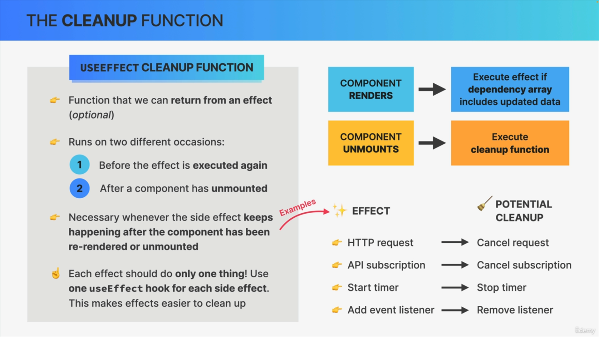

If you use any state variable in cleanup function, it will create a closure with it.

Even though celanup function is called after the component is unmounted (means destroyed along with all its states and props), it can hold the reference to the state vars because of closure.

Add a console in cleanup function.

As clean up runs in every re-render, it will hold reference to old values of state.

Let say, intially state var is "a" and later changed to 'b'.

So after seState("b"), the console in cleanup will log 'a'

### Solving Race condition issue using AbortController:

##### AbortController is a Browser API just like fetch, which will cancel all previous request If controller.abort called in cleanup func of useEffect.

Step-1: const controller = new AbortController();
Step-2: fetch('API url', {signal: controller.signal})
Step-3: In useEffect: 
```
useEffect(() => {

    fetchData(); // which does the fetch call

    return function(){
        controller.abort();
    }
})
```


##### Example Code same as Lecture 9:
```

function getRandomData(data, controller) {
 return fetch('API url', {signal: controller.signal}).then(res => res.json());
}

const App = () => {
    const [searchText, setSearchText] = useState('');
    const [result, setResult] = useState('');

    const onChange = (event) => {
       const { value } = event.target;
       setSearchText(value);
    }

    useEffect(() => {
        const controller = new AbortController();
        const resp = await getRandomData(searchText, controller).then((val) => {
            setResult(val);
        });
        
        return () => {
            controller.abort();
        }
    }, [searchText]);

    return (
        <div className="App">
            <input name="search" placeholder="search" value={searchText} onChange={onChange} />
            <div>{result}</div>
        </div>
    );
}
```
