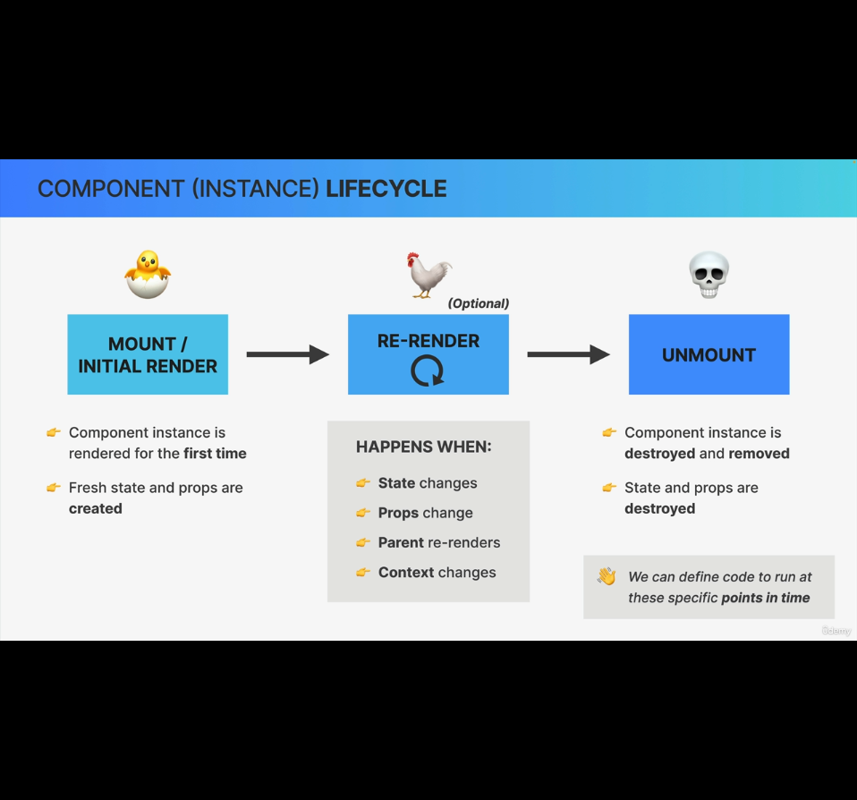

### Component (Instance) Lifecycle
The lifecycle of a component basically means the different phases that a specific component instance can go through over time.

#### First phase: Mount/Initial Render
- The first phase in any component life cycle is that component instance is mounted, which is also called initial render.
- This is when component instance is rendered for the first time
- Fresh state and props are created.

#### Second phase: Re-render:
- Once the component has been rendered and is on the screen, it can be re-rendered unlimited number of times.
- A component instance is re-rendered, when:
    - state inside the component changes
    - props changes
    - parent component re-renders
    - context changes

#### Third phase: Unmount:
- Component instance is completely destroyed and removed from the screen along with its states and props.

We can hook into the components in a specific phase of its lifecycle and run code as per need.

