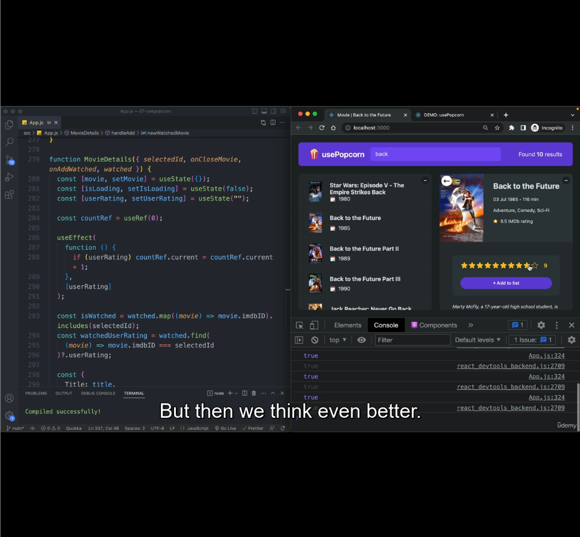

Usecase: In movie app, we want to log, how many times the user rates the movie before adding it to list.

Let say user first rated the movie: 5 Star, Then updated to 8 star and finally updates to 7 star. So the count is 3.

We can keep a state value initialized as 0 and everytime user updates we can update the state as well. But it will re-render the application. But we're not showing this count anywhere in the UI. So do we need to repaint the browser ? No

The solution is refs. We just want to store the value, but don't want to render.

This time we update the ref, everytime `userRating` state updates as shown in line 288 in a useEffect.

** Reading / Writing from ref is recommeneded in a useEffect.