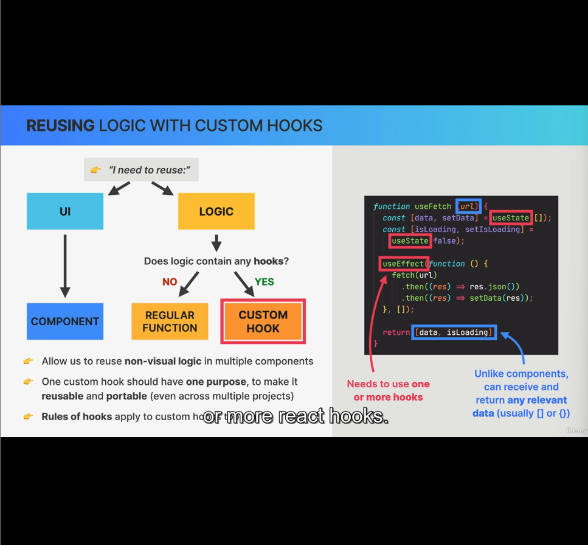

### Reusability in React:
In React we have basically two type of things that we can reuse:
1. A piece of UI - How? Use components
2. A piece of logic - How? Depends whether the piece of code contains a hook or not
    2.1. **If no hook**, then you can use a reguar JS function.
    2.2 **If there's a hook**, you need to use a custom hook.

#### Custom hooks:
A function that receive and return data like regualr JS function. But it has capability to use one more react hooks, which was not possible in nomral functions.

1. Allows us to reuse non-visual in multiple components.
2. Though it is majorly used to abstract out stateful logic that uses one or more hooks, it can be used to abstract out simple logic without hooks as well.
3. One custom hook should have singular well defined purpose, to make it reusable by other components and even other projects. Based on the concept of custom hooks, there are many publicly available npm packages.
4. Since custom hooks are made out of the regular react hooks, the rules of hooks apply to these custom hooks as well.

#### Note:

1. A custom hook at the end is a regular JS function that can receive and return any data.
    - How it's different than a react component: React component receives any props, but has to retun some JSX.
    - How it's different than a regular function: Custom hook has to use one or more react hooks.
    - **Important**: The name of the custom hook has to start with the word *use*, for us and React to recognize that it's a hook, like all builtin react hooks. Otherwise React will consider it as a normal function. Hence this is a mandatory rule.

