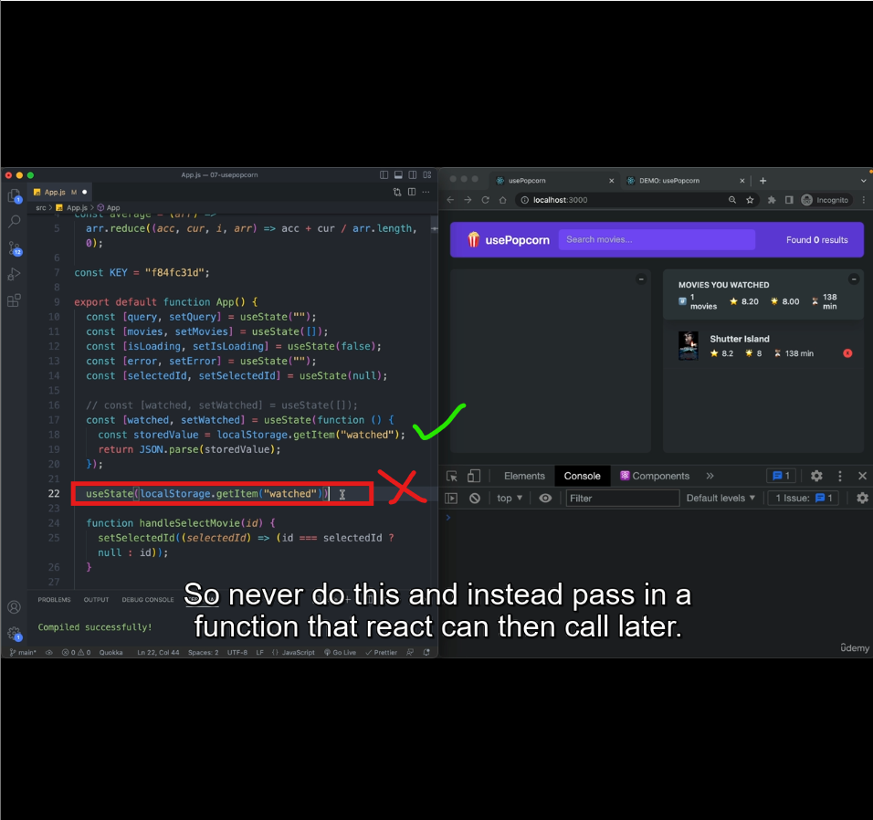

As of now this is clear that the initial state we pass to useState is only considered for the first time, when the component mounts for the first time. and not for the subsequent re-renders, no matter you use the below syntax of lazy initial state or normal initial state.

*This can be solved using useEffect with empty dependency array,* But is there a better alternative? Yes callback syntax of useState.

### Rules for the callback we pass to useState:
1. This(Callback we pass to useState) should be a pure function.
2. This callback shouldn't take any args.
3. We need to pass reference of the callback in useState and shouldn't call it inside useState. Otherwise it will run in every re-render.

### Problem:
1. What if the initial state you want to set isn't a primitive value and you need to derive it by running a piece of code. 
    - If we wrap the piece of code in a function, we need to call it outside the callback we pass it to useState, as per the rule#3. Because we can't do `useState(deriveValue())`. Becuase doing so will run the function in every re-render as mentioned in Rule3
    - If the `deriveValue()` is called in component function, it will be executed everytime the component re-renders.
2. As an alternative to 1st problem, we can use a `useEffect` with empty dependency array. But this is an alternative.

Using a callback to initialize in useState, is also called *Lazy Initial State*.

## Lecture 6: useState Summary:
*While updating state, update in immutable way.*
