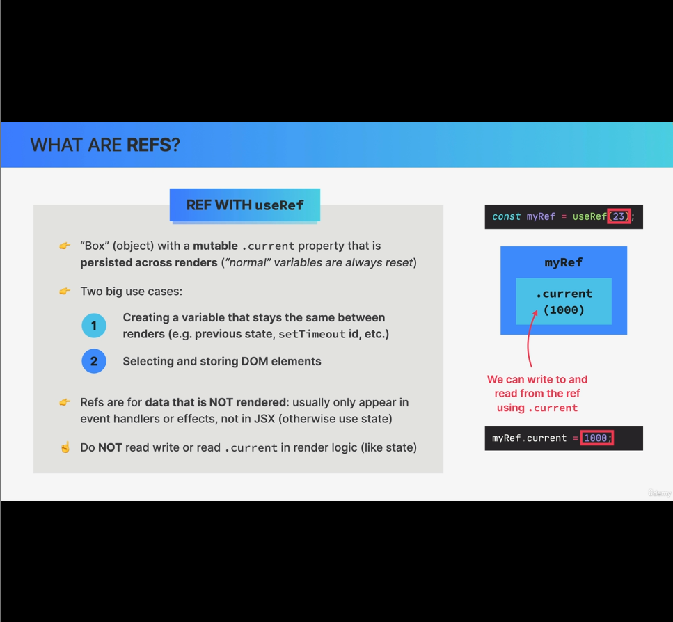
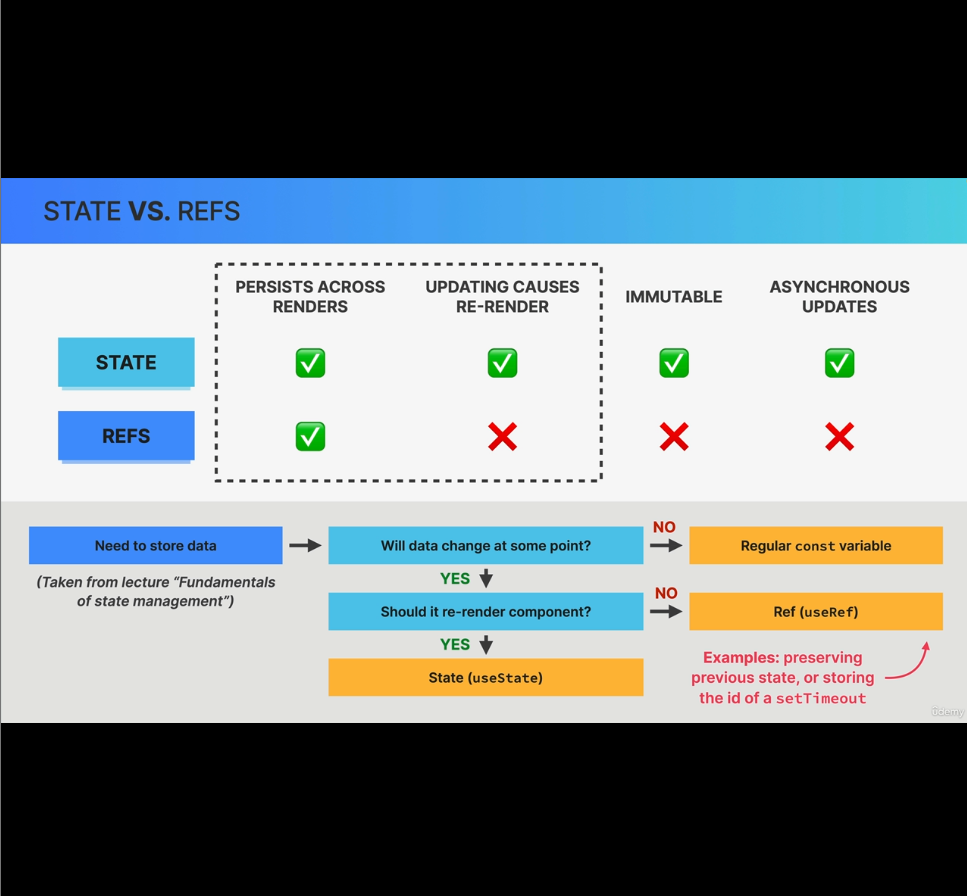

### What are refs?
useRef in React returns an object with mutable **current** property and we can then write any data into this current property and ofcourse can read from it. 

#### What's special about refs?
- current property is mutable unlike everything else in React.
- values in refs are persisted across renders in current property.

#### Two usecases where refs are very helpful:
1. Creating a variable that stays the same between renders (e.g. previous state, setTimeout Id etc.) - lecture-10
2. Selecting and storing the DOM elements. - lecture-9

#### Note: Ref are usually for storing data that is not rendered. Usually only appear in event handlers or effects, not in JSX
- We can ofcourse use refs in JSX. But If you need data that participates in the visual output of the component, use a **state** variable. Updating a state won't trigger a re-render.
- **Important:** Writing or Reading a ref in render logic is not allowed as this could lead to undesirable side effects. Instead we usually do these mutations in a useEffect hook.
    - Why we usually do these mutations in a useEffect hook?
        - Because when 
            - we attach a ref to some html element, you'll get the value in ref only when once the component is mounted. That's in useEffect hook with empty deps array.
            - Or If you want to update ref value based on state update, you can useEffect in that scenario as well with state value in deps array of useEffect.

### State vs Refs:
- What both of these have in common is: they both persisted across renders.
- The difference is:
    - updating state will cause re-render, but updating refs won't do any re-render.
    - Updating a state is asynchronous. Hence accessing a state just after updating won't give the correct data.
    - Updating ref is synchronous. Hence accessing ref value just after updating will give the latest data.

