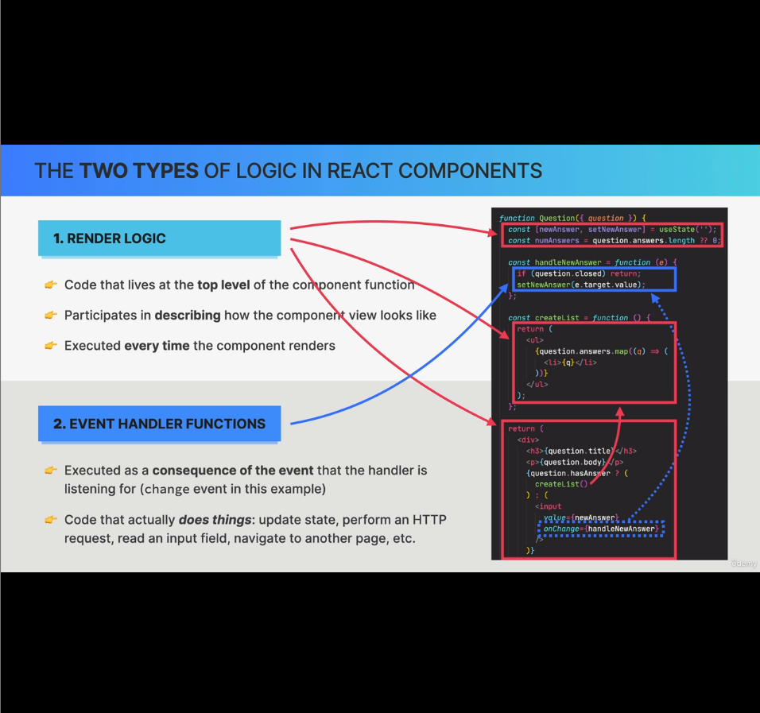
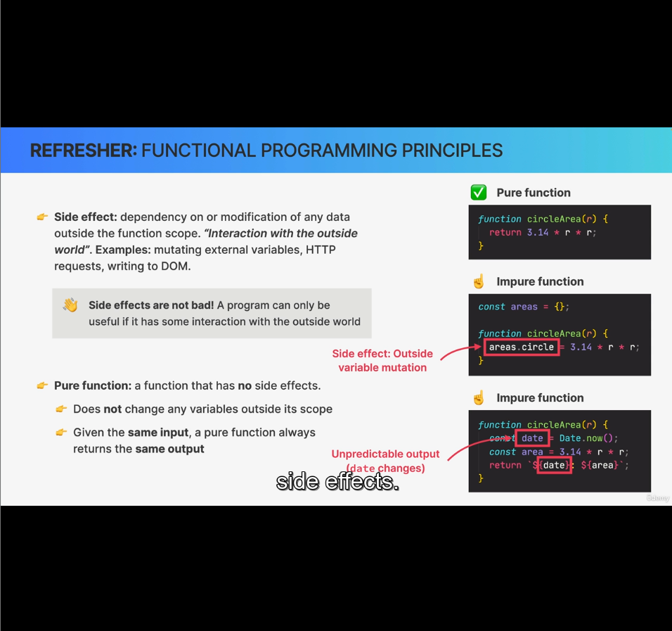
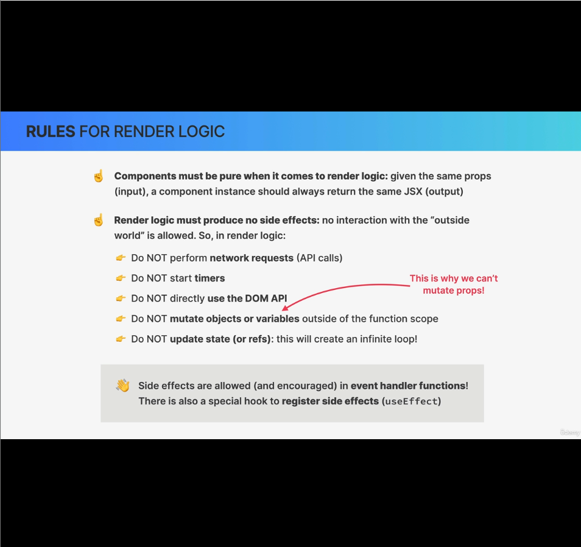

In order for the rendering process to work in the way that we just learned before, our render logic needs to follow some simple rules.

### What actually is render logic?
There're two types of logic in React components.
1. Render logic
2. Event handler functions

#### 1. Render logic:
- Code that lives at the top level of the component function.
- Participating in describing how the component view looks like
- Executed every time the component renders
- Example in the pic attached:
    - In this code snippet, the state variables, the return blocks, functions invoked from the return block are part of render logic

#### 2. Event handler functions:
- Executed as a consequence of the event that the handler is listening for (change event in this example)
- Code that actually does things: update state, perform an HTTP request, read an input field, navigate to another page etc.

##### Note:
1. It's important to differentiate between these two types of logic because they do actually do fundamentally different things.
2. While render logic is code that renders the component, event handlers contain code that actually make things happen in the application.
3. Event handler contain things like state updates, http requests, reading input fields, page navigation.

#### Why these two logics are important?
It's important because react requires that components are pure when it comes to render logic in order to everthing to work as expected.

What does pure logic mean? Let's understand by understanding *Functional Programming Principles*:

- Side effects:
    - Dependency on or modification of any data outside the function scope. "Interaction with the outside world". 
    Example: Mutating external variables, HTTP requests, writing to DOM.
    - Side effects are not bad. A program can only be useful If it has some interaction with the outside world. 
- Pure function:
    - a function without any side effects.
    - Does not change any variables outside its scope
    - Given the same input, a pure function always returns the same output.

### Rules for Render logic in React components:

Side effects avoided in Render logic, but can be added in Event handlers though.