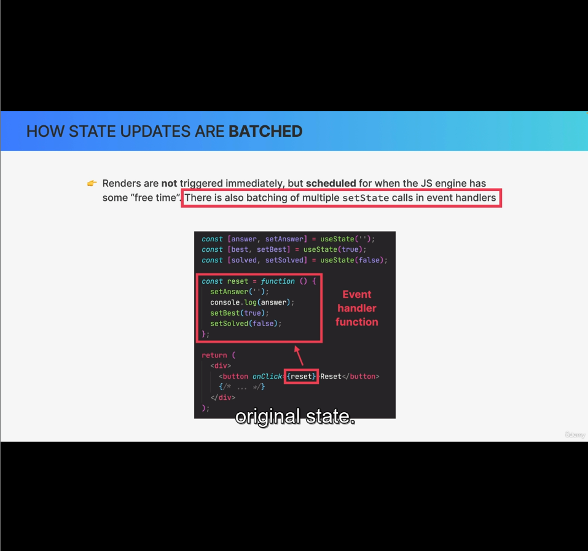
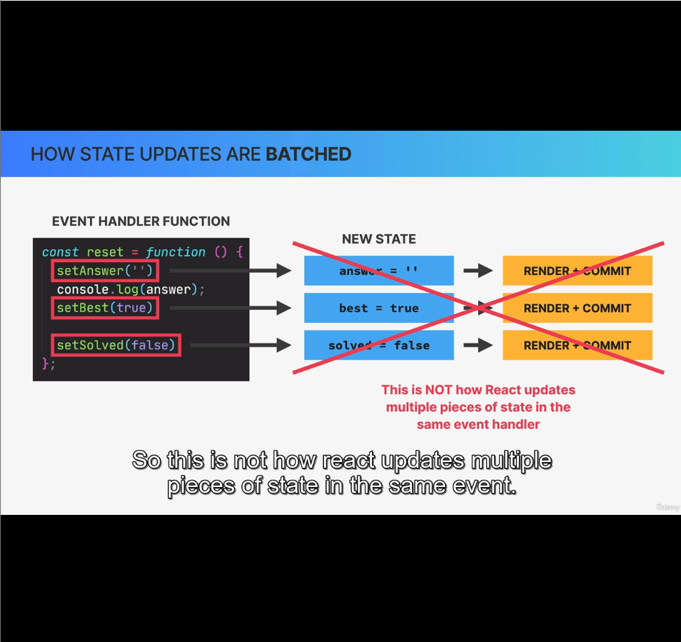
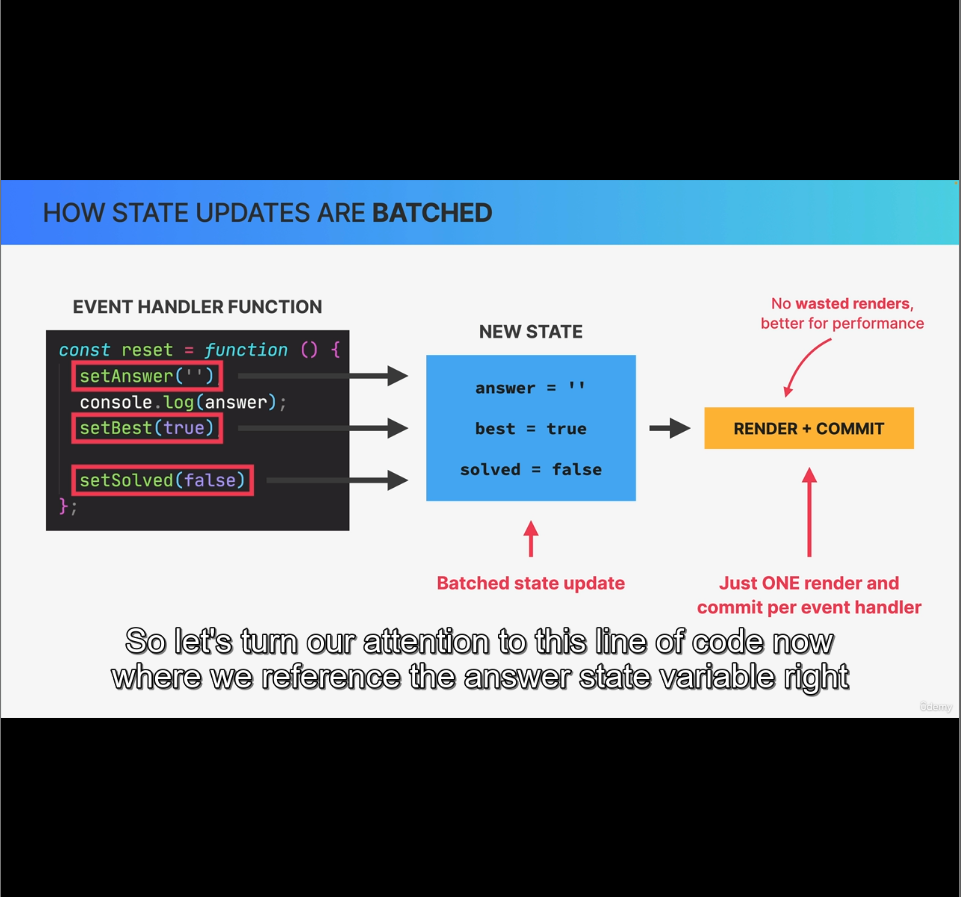
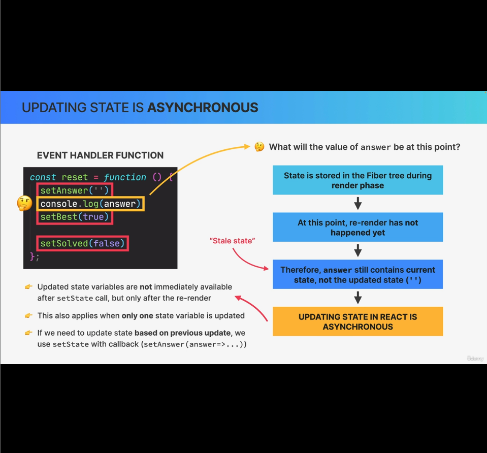

Agenda: State updates are batched

### How state updates are batched

- Renders are not triggered immediately, but scheduled for when the JS engine has some free time.
- There is also batching of multiple `setState` calls in event handlers (This is discussed in detail in this lecture.)

#### code example:

In above code example, there're three states and on click of reset button, we're updating the 3 states.

In the event handler function we're calling multiple setState calls. The motive of this lecture is to understand, how these threee pieces of state are actually updated behind the scenes.

Breaking wrong assumptions:

As shown in image above, each state update doesn't trigger a Render + Commit phase immediately.

Instead these state updates will actually get batched into just one state update for the entire event.

### Updating state is asynchronous:

### Batching beyond event handler functions:
So far we have only talked about batching in event handler functions like our reset function..

*That's becuase before React18, React only did automated batching in event handlers, but not in situations that happen after a browser event has already happened*

#### Batching in React18 vs React17:
In React18, batching is available inside timeouts & promises and native event listeners as well, when multiple `setState` are called.

Before React18, If you call `reset` function shown in code snippet at start of lecture 15, it would trigger multiple renders for each state update calls. As we're updating 3 state variables in `reset`, it would render 3 times.

*It's important to know that batching works differently in React 17 and older versions.*

In some rare scenarios, state updates can be problematic, so we can opt out automatic batching by wrapping a state update in `ReactDOM.flushSync()`. (Might need in very rare situations). This will exclude the state update from batching.
