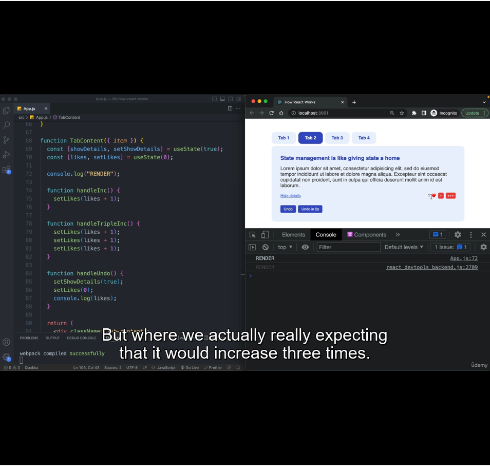

We're doing practice of what we learnt in last lecture here.

In the pic above, in our demo app, we attached event listeners to `undo` button and `Triple+++` button and in each event listeners, we're making multiple setState calls to show how these are batched and results in just one render.

We added a `console.log('RENDER')` at line#72 to validate the number of renders it goes through.

#### Observation-1
When clicked on Undo, it ran handleUndo, just one `RENDER` was logged in console.

#### Observation-2:
The default state at line# 69 & 70 is `showDetails` as `true` and `likes` as `0`.

So when app rendered for the first time, the value of these state will be true & 0.

I increased the likes t0 5 by clicking single + button 5 times and clicked Undo, which resets state to 0 again.

Now If you click Undo button again, you won't show 'RENDER' in browser console. That's becuase the current state is same as the state we want to set in handleUndo().

