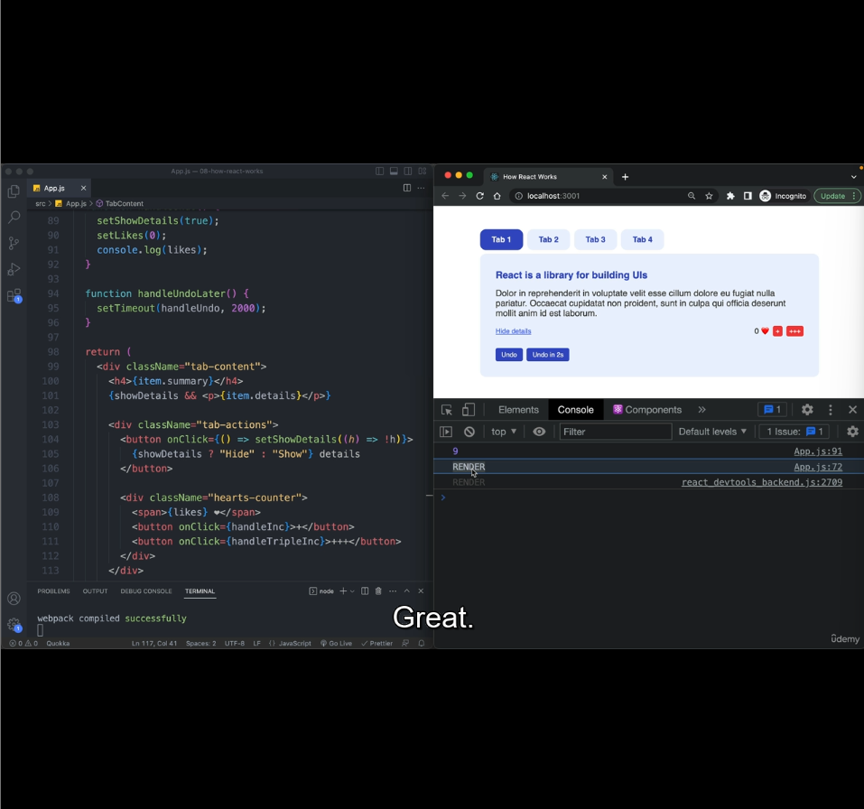
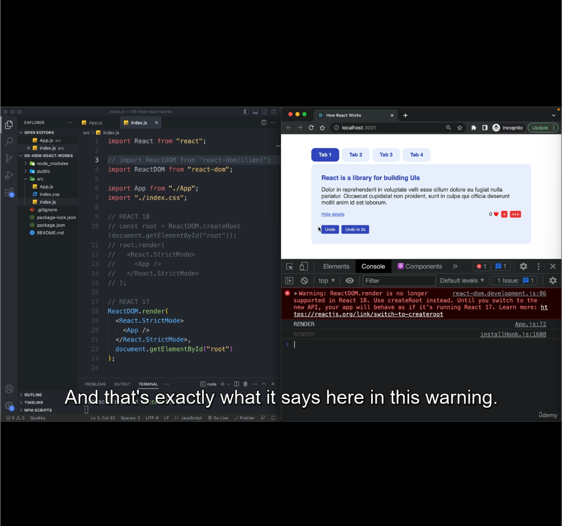
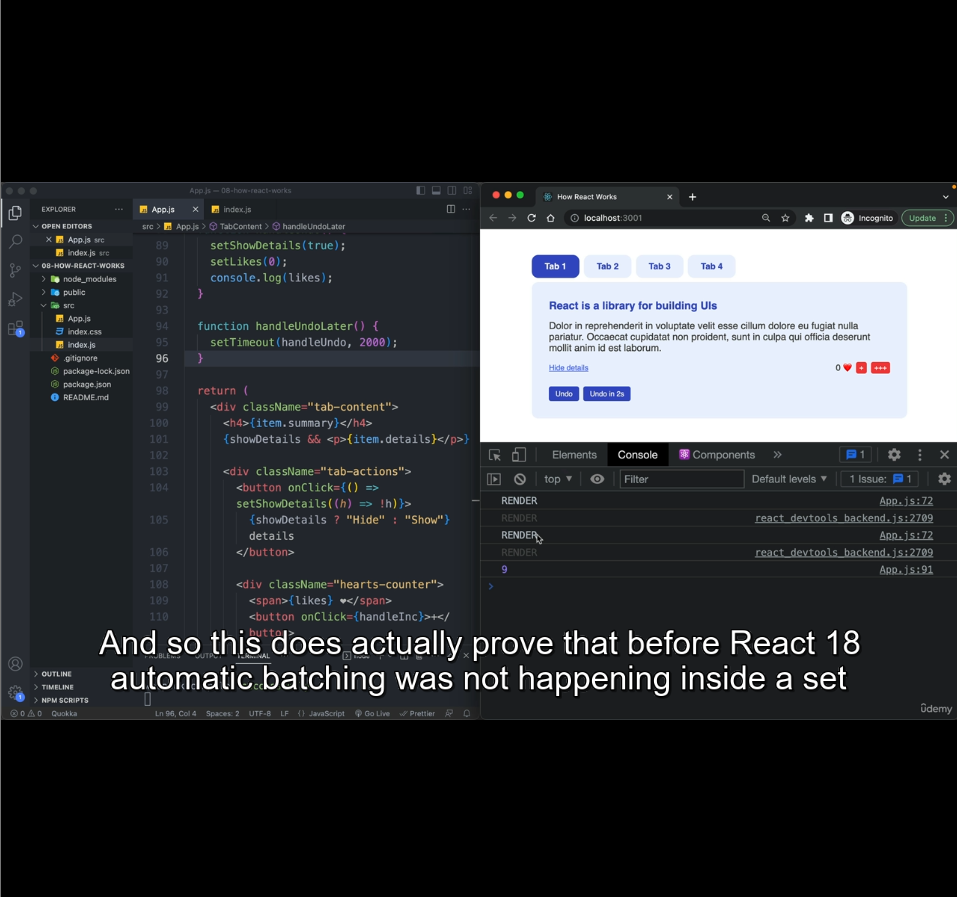

We're doing practice of what we learnt in last lecture here.

In the pic above, in our demo app, we attached event listeners to `undo` button and `Triple+++` button and in each event listeners, we're making multiple setState calls to show how these are batched and results in just one render.

We added a `console.log('RENDER')` at line#72 to validate the number of renders it goes through.

#### Observation-1
When clicked on Undo, it ran handleUndo, just one `RENDER` was logged in console.

#### Observation-2:
The default state at line# 69 & 70 is `showDetails` as `true` and `likes` as `0`.

So when app rendered for the first time, the value of these state will be true & 0.

I increased the likes t0 5 by clicking single + button 5 times and clicked Undo, which resets state to 0 again.

Now If you click Undo button again, you won't show 'RENDER' in browser console. That's becuase the current state is same as the state we want to set in handleUndo().

#### Observation-3:
The `likes` state is mapped to the number beside the heart icon in UI.

When app rendered for first time, value of `like` is 0. And If I clicked `+++` icon, `handleTripleInc` is called. What should be reflectign in UI?

It will be 1 only, even though, we've `setLikes(likes+1)` 3 times in `handleTripleInc()`.

This is the example showing state updates are asynchronous.

If you're expecting the value of `likes` to be 1 after line# 79, you're wrong.

To achieve increment by 3, either you have to use callback synatx to update in setState function, if the state update depends on previous value of the same state.

or `setLike(likes + 3)` will work.

#### Observation-4: State updates are batched in timeout functions:

In UI, attached `handleUndoLater` event handler to `Undo in 2s` button.

When `Undo in 2s` is clicked, it triggered `handleUndoLater` and it scheduled to run `handleUndo` after 2s.

In `handleUndo`, we call multiple setState calls. But in browser console, one one `RENDER` is logged.

As Jonas is using React18, it prooves that, React18 is batching multiple state updates in setTimeout as well.

#### Observation-5
Even though we've installed React18 in node_modules, there's a way to instruct `React` to work in `v17` way.

Two changes to switch back to v17:
1. `import ReactDOM from 'react-dom'`, import from `react-dom` instead of `react-dom/client`
2. Instead of root.render(), use `ReactDOM.render()`

Also after doing the above two change, in browser console we're able to see the warning which says the App will work as if it's running in v17.
Now If you click on `Undo in 2s` or any other button that led to multiple state updates inside setTimeout or promises, you'll see multiple `RENDER` logs in browser console.

