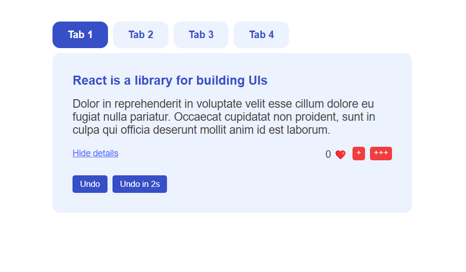
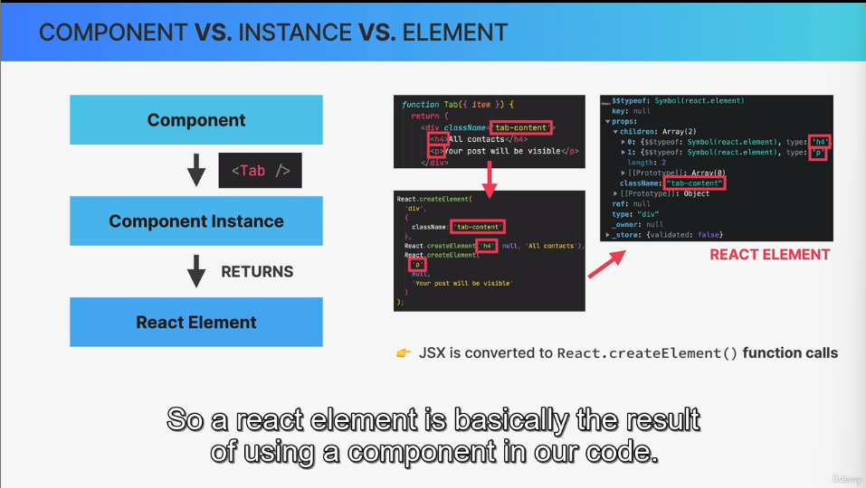
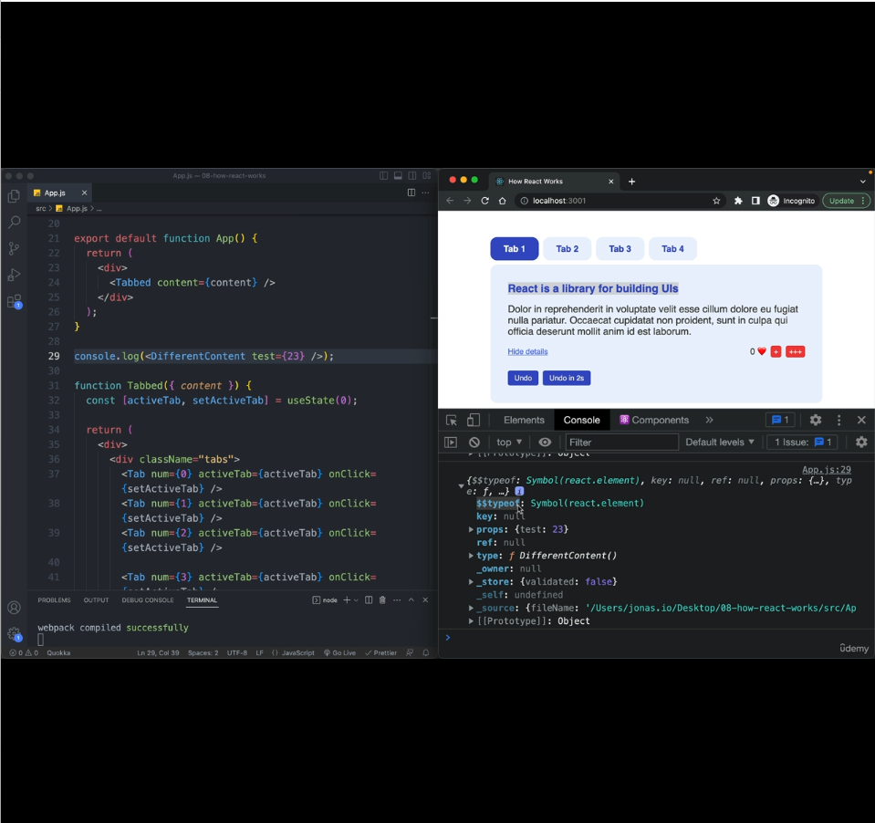
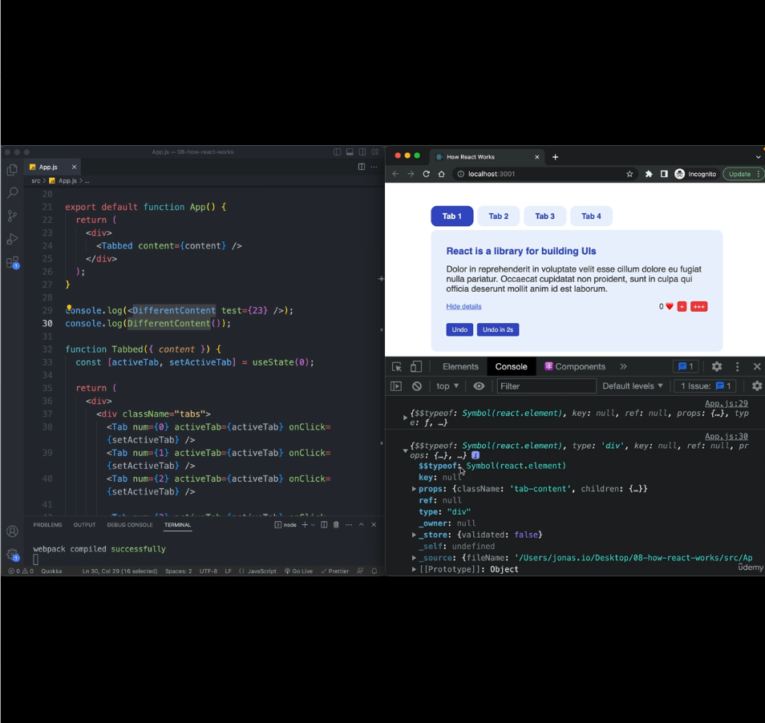
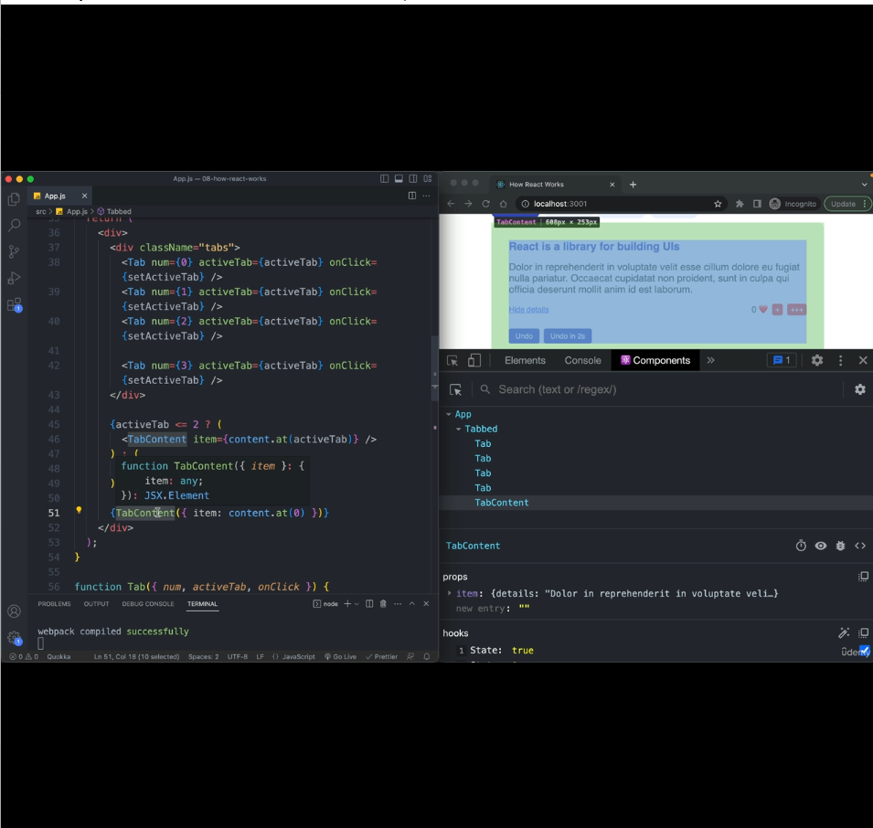
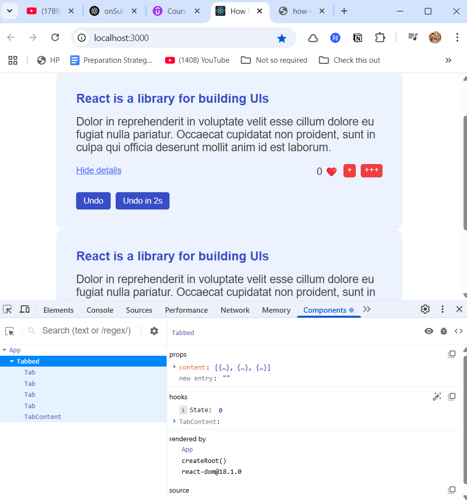

### Lecture 2 : Project Walkthrough
At top there are 4 tabs. But the array on which we looped over has only 3 elements.

On clicking each tab, we set the active tab to index of array.

On clicking last element, we set activeTab to 3.

If activeTab is > we show a different component using conditional rendering.

- activeTab < 3 :  Show `<TabContent />`
- activeTab > 3 : Show `<DifferentContent />`

When activeTab is 2 and we changed to 3, `TabContent` is unmounted and we mount `DifferentContent` at same place in DOM.



### Lecture 3: Components, Instances & Elements.
##### Components:
Components are functions
```
function TabContent (){
    return (<h1>Tab</h1>)
}
```
##### Component Instances
When we use components in JSX syntax with angular brackets, components are called internally like a function and a component instance is created.
`<TabConent/>` -> `TabContent()`
```
<TabContent />
```
#### Element:
When a component function is called by React like a function, it will return React elements. TabContent returns a h1 html element, but it will be converted to React elements and return it.
`React.createElement('h1', {}, 'Tab');`
React.createElement behind the scenes will be converted to a huge immutable javascript object with all properties & functions required to create DOM element render it in actual DOM, for the current component instance. These huge objects are kept in memory by React and managed by React.

Note: It's not react elements that are rendered to the DOM. React elements are just kept inside React app in memory and has nothing to do with DOM. They're simply used to create DOM elements.



### Lecture 4: Instances and Elements in Practice:

In this lecture, we console logged `<DifferentComponent />` and `DifferentComponent()` and analyzed the differences in React element created when a component instance is created using `JSX syntax` vs `a function call.`

#### Logged `<DifferentComponent />` in JSX way:




Do you see the `$$typeof` key in the object logged, coming beacause of Line#29.

`$$typeof` is of Symbol type, a primitive datatype in JavaScript. It's a security feature developed by React devs in order to protect us from Cross-site scripting attacks.

Symbols is one of primitive datatype that can't be transmitted in JSON. Generally UI Single page apps consume JSON data from any backened to show data in UI. If some hacker sends us fake react element from backend, then that react element object won't have `$$typeof` as a Symbol. And React will discard any react element without $$typeof as Symbol and won't render it in UI.

- type: There's another type property whose value is a function and name of the function is same as the component name.

React internally calls the component function when it encounters the Component in JSX. 

So, can we call the component function directly like `DifferentComponent()` instead of using it in JSX like `<DifferentComponent />` ?
Answer: No

There're few differences when we call it like a function and when it's called internally by React when it's used in JSX.

Let's analyze the diff below:
#### Logged `DifferentComponent()` in function way:




If you observe carefully, type property is no longer of function with component name now. It's div. This is because we're returning a div from `DifferentComponent`. So type is what is returned from thecomponent function and not the component function itself. That simply means react no longer sees it as a component instance.

- `$$typeof` is still a symbol though



In pic above, you can see we're rendering TabContent at Line#51 using functions.
It rendered in DOM as well. But it won't work as expected.
- In devtools even though there're two instances of TabContent, it's showing only one,as React is not considering TabContent returned from a function as a valid component.
- In TabContent we have two state variables created using useState, which is managed by it's parent `Tabbed` component and not by `TabContent` component itself, even though the state vars are local states.



Remove TabContent() and see the difference in React Devtools.

Summary: Do not return react elements created using function syntax from a Component function.