### Recap of what is covered in this section till now:
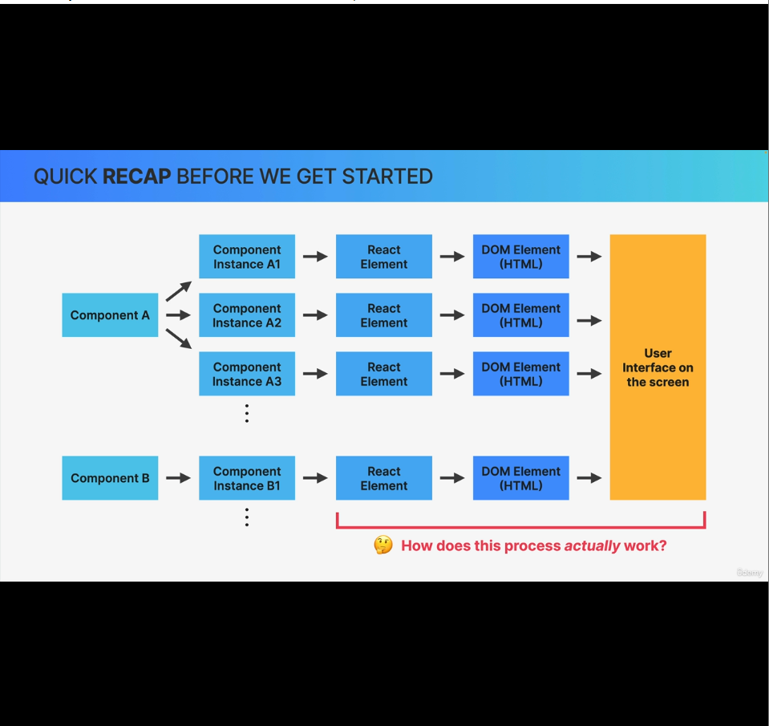

How does component instances are dsiplayed in Actual DOM will be answered next!

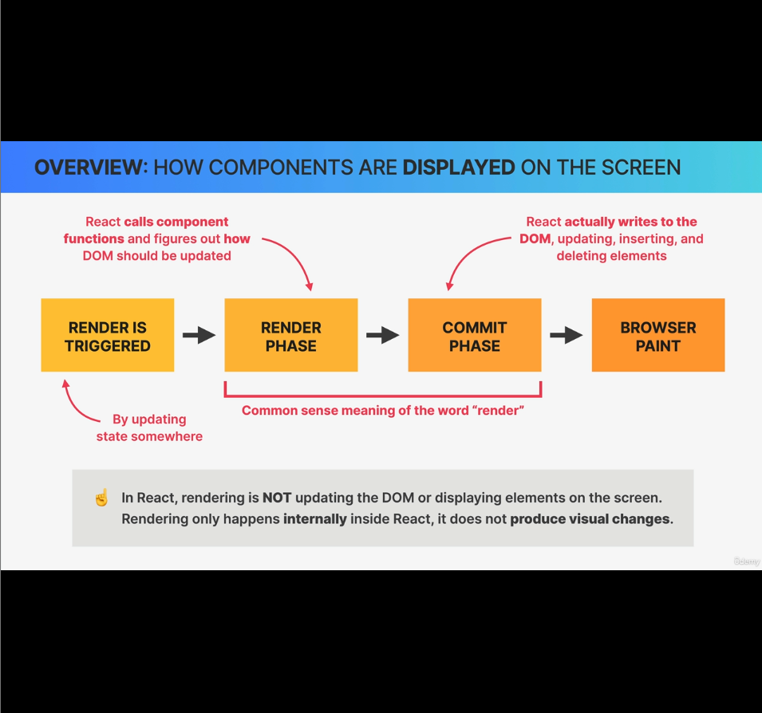

1. Step-1: Render is triggered: State is updated somewhere in application, which triggers a render
2. Step-2: Render phase:
    - In React, Render doesn't mean updating the DOM or displaying elements on the screen. It doesn't produce visual changes.
    - Render means the component function is called again to analyze the new Object returned from React.createElement calls and figure out how it's different from its previous snapshot and how the DOM should be updated to accomodate the new change.
3. Step-3: Commit Phase:
    - In this phase React actually writes any new element to DOM If required and updates or deletes existing elements, based on the analysis derived from the previous step; i.e. Render phase.
    - Hence the english term "Render" is different from what "Render" means in React applications.
    - In React, (Render phase + Commit phase), together means the Render term in English.
4. Step-4 Browser Paint:
    - Finally browser will notice that the DOM has been updated and it repaints the screen.
    - This step has nothing to do with React anymore. This is the job of Browser and this is the step that leds to visual change and not by Render or Commit phase of React.

Next, we'll zoom-into each of these 4 steps and understand in detail what happens behind the scenes.

### Step-1: Render is triggered:
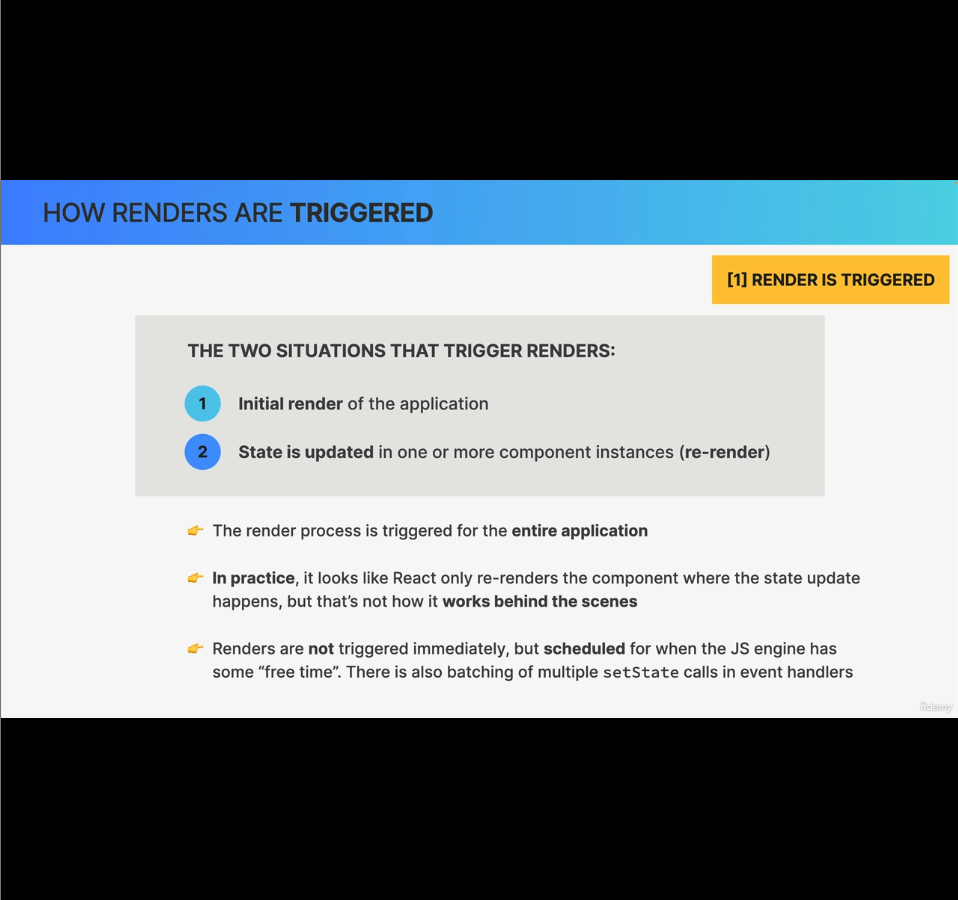
- Two ways when a render is triggered:
    1. Initial render of the application
    2. State is updated in one or more component instances (re-render)

The render process is triggered for the entire application, not for just one single component. But that doesn't mean the entire DOM is updated. Because as we learnt, In react, rendering means only calling the component function and figuring out the change in DOM, that needs to be done later.
Image-1:
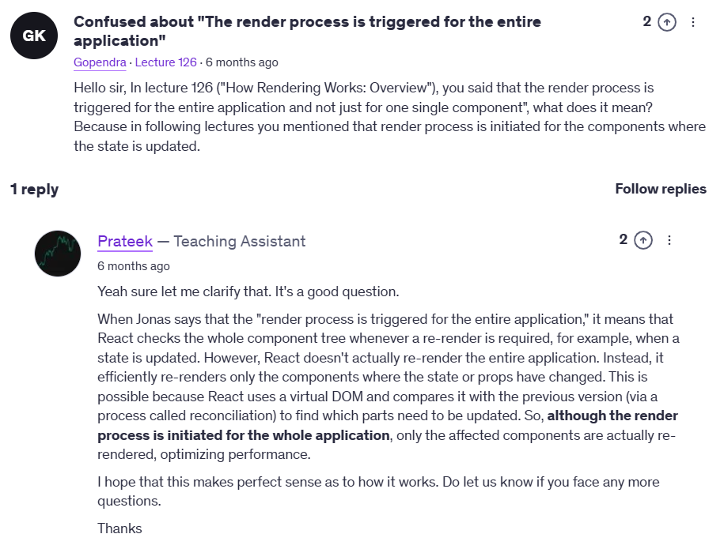

Image-2:

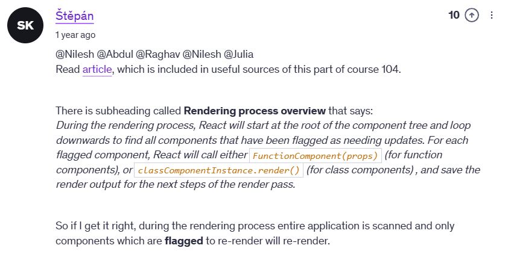
Note: Render process is triggered for whole app means, it scans all components from the very root app and only calls the component function if it is flagged.

Also renders are not triggered immediately, but is scheduled. Also mutiple setState calls are batched.

### Step-2: Render phase:

Before proceeding with render phase, let's break the myth. Till now we disussed that when a state is updated, React discarded the old component view and replaces it with new one, which is not **TRUE**.

*DOM will actually not be updated for the entire component instance.*

One more pre-requisite for understanding Render Phase: i.e. Virtual DOMs

#### Virtual DOM:
- Virtual DOM is nothing but, another name of React eleemnt tree.
- On Initial render, React will take the entire component tree (consists of all component instances) and transform it into one big React element tree, which is known as *Virtual DOM*.
- It's relatively cheap & fast to create a React element tree or Virtual DOM, as it's just a javascript object behind the scenes in memory.
- And this is considered cheap even when we create multiple such trees on every state update.
- One important thing about VirtualDOMs/React-element-tree:
    - If a state update happened in a component, React will re-render all of its child components, no matter if that component is consuming the updating state as a prop or not.
    - That means If a state update happened at the root component, the entire application will be re-rendered.
    - Again re-rendering doesn't mean the actual DOM is updated, but the corresponding component functions are called and a new virtual DOM will be re-created.
    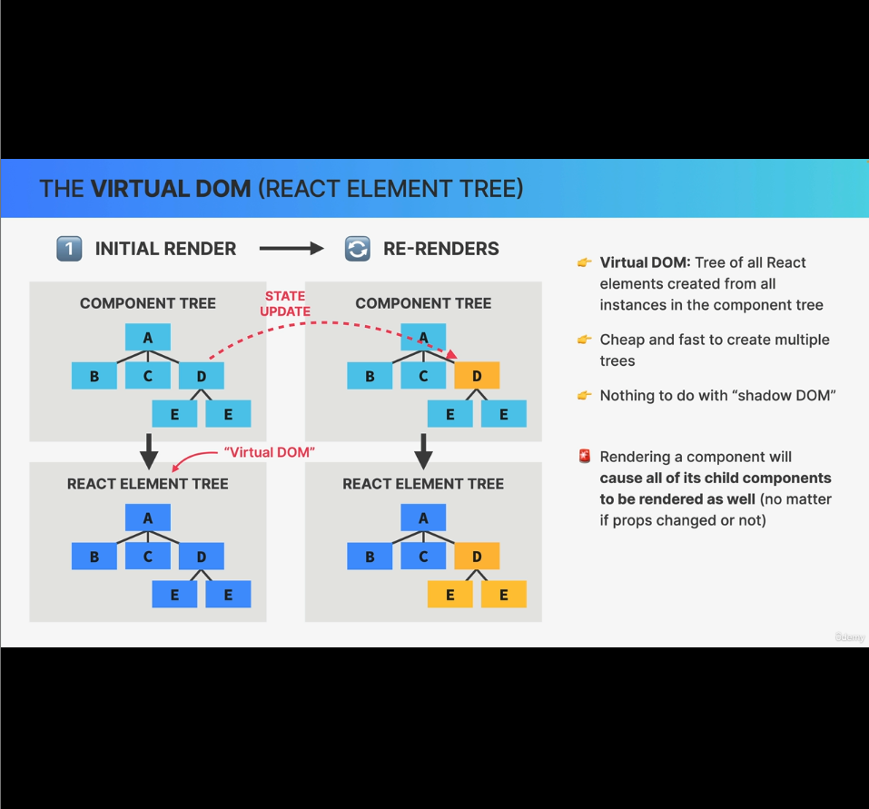
- It has nothing to do with *Shadow DOM*, both of these are different.
- Shadow DOM is actually just a browser technology used in stuffs like web components. Example of web componennts are  `<video>`, `<audio>`. In video elements there's controllers/buttons in the video block to play/pause and other things, for which you won't show the elements in browser devtools by default. It's developed by Browser companies.

Now coming to render phase:

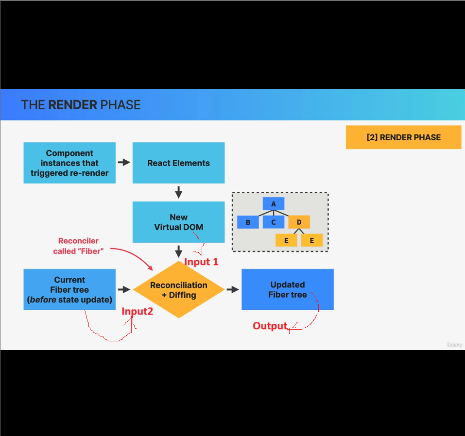

1. React will scan throguh all components and pick only those components that triggered re-render and call them, which indeed will return React elements. So the component trees will be transformed to a new React element tree(Virtual DOM).
2. The new virtual DOM will be reconcilled with the old mutable *fibre* tree(generated from virtual dom of initial rendering) and update the same fibre tree by looking at the new virtual DOM. This updated fibre tree will be eventually used to write to the DOM.
3. This reconcillation will be done using the React's reconciller, which is called Fibre.
*Note: In simple terms, reconciliation means making two things match or agree*

Let's understand the new terms introduced in last discussion:
##### What is reconcillation and why do we need it?
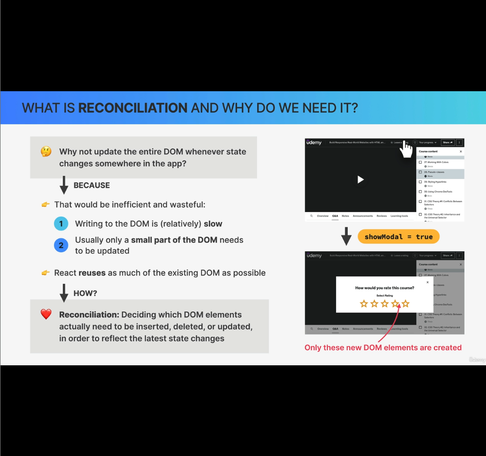
Reconcillation is a step for deciding which DOM elements actually need to be inserted, deleted or updated in order to reflect the latest state changes.

But why to decide and why can't we update the entire DOM whenever there's a state change? 
- Because, writing to DOM is a heavy operation.
- Also If a small part of the DOM need to be changed, no point updating the entire DOM, as it's a heavy operation.
- Whereas deciding which DOM elements needs to be updated by creating a new virtual DOM is relatively much cheaper. 
- React reuses as much of the existing DOM as possible.

##### The Reconciler of React: Fiber:
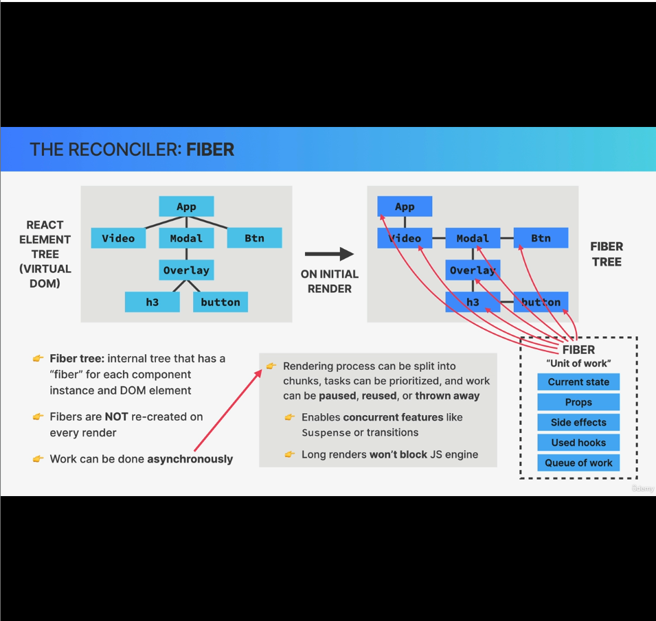
How Fiber works:
1. During initial rendering of the application, **fiber takes** the entire React-element-tree/virtual dom and based on it builds another tree, which is the Fiber tree.
2. How fiber tree is different than the react-element-tree?
    - The fiber tree is a special internal tree where for each component instance and also **for normal html dom element** in app, there's one node, called fiber.
    - Unlike virtual doms, fibers are not created on every re-render or state update.
    - If you check the image, you'll see it's a LinkedList data structure unlike the react element tree.
    - So fiber tree is never destroyed since its creation during initial rendering. Instead it's a mutable data structure, where the same tree gets updated on each render phase over and over again.
    - As fibers never gets destroyed since, it's a perfect place for keeping track of actual state and of props of any component that we see in screen and these are internally stored inside the corresponding fiber of the fiber tree.
        1. State of that component (useState)
        2. Props
        3. Side effects
        4. Used hooks
    - **Imp: Now each fiber also contains a queue of work scheduled like updating the state, updating the refs, running registered side effects, performing dom updated and so on.**
    - That's why fibers are also called Unit of work
    - Fiber, unit of work, has an extremely important characteristics that, work can be done asynchronously.
        1. Rendering process can be split into chunks, tasks can be prioritized and work can be paused, reused or thrown away, If not valid anymore.
            1. This asynchronousity characteristics enables cocurrent features like **Suspense** or **transitions**, staring in React v18.
            2. It also allows the rendering process to pause and resume later so that it won't block the browser's javascript engine with too long renders, which can be problematic for performance in large applications.
                - It's only possible because output of render phase doesn't produce any visible change to DOM.

Now as we know what a fiber reconciler is and how it works, let's understand the reconcillation process now:
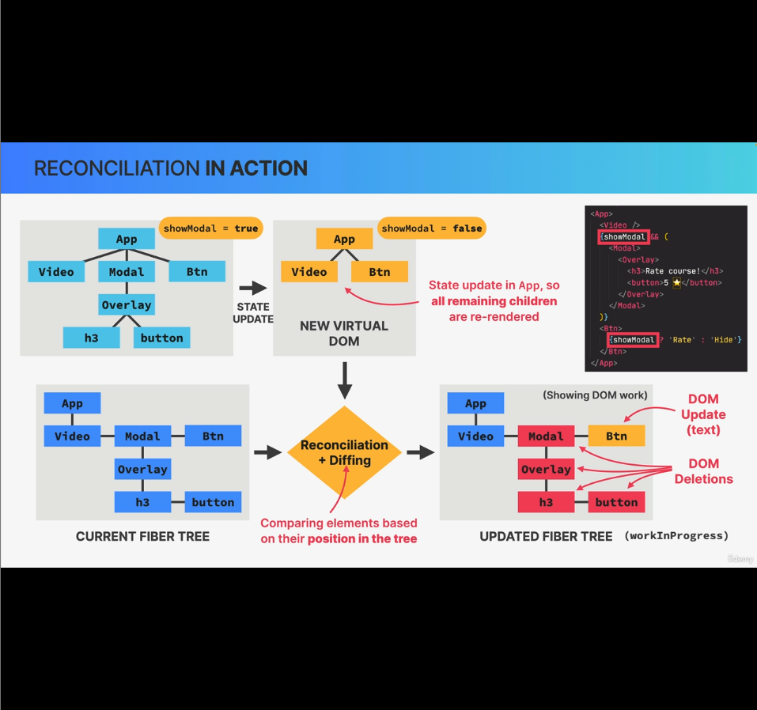

The pic above is very self-explanatory.
showModal state is updated to false, hence all components those are conditionally rendered based on values of showModal is deleted.
Also the non-react HTML dom element like button is also updated with the correct text.
Components marked in yellow are re-rendered. and marked in red are deleted.
- video componment is just re-rendered as it's child of App even though there's no state update in video.

Diffing:Comparing elements based on their position in DOM.

#### Output of Render phase:
Once we got the updated fiber tree and we figured our the list of DOM deletion or updation required, these list of actions will be placed in something called *List of effects*, which will be used in next phase; i.e. Commit phase, where the dom will be mutated.

DOMS has still not been updated yet.
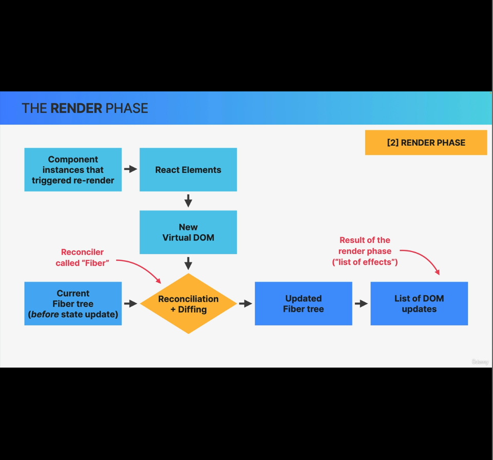
