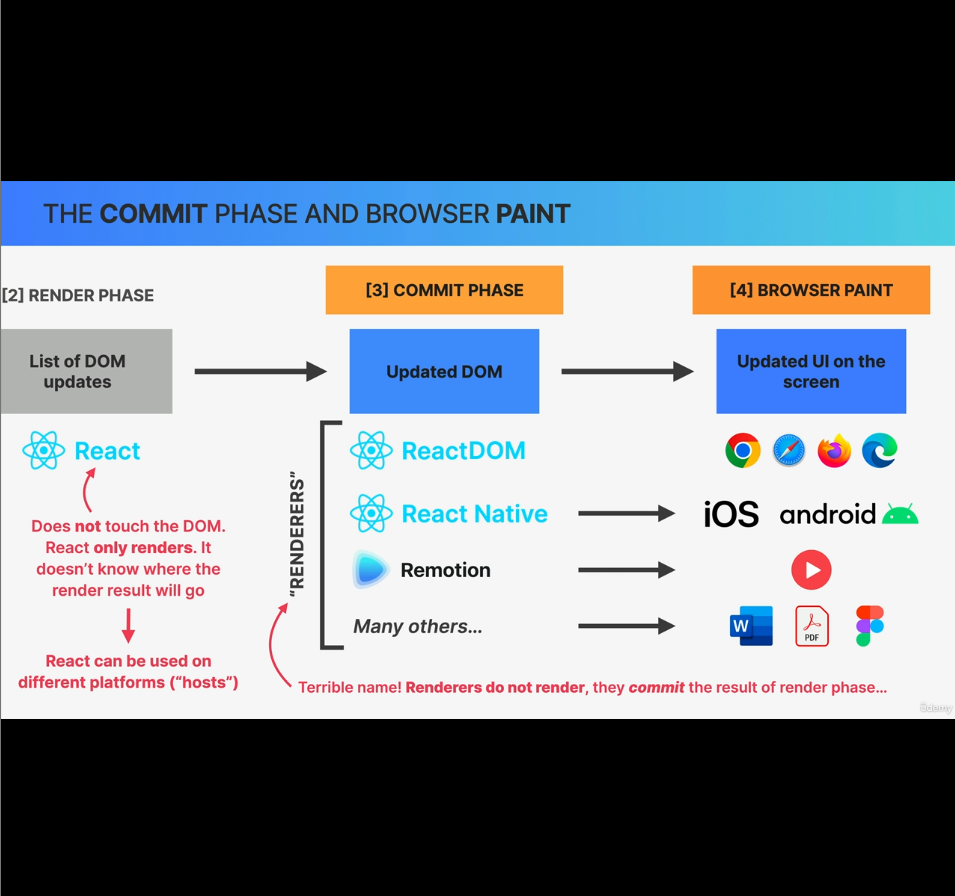
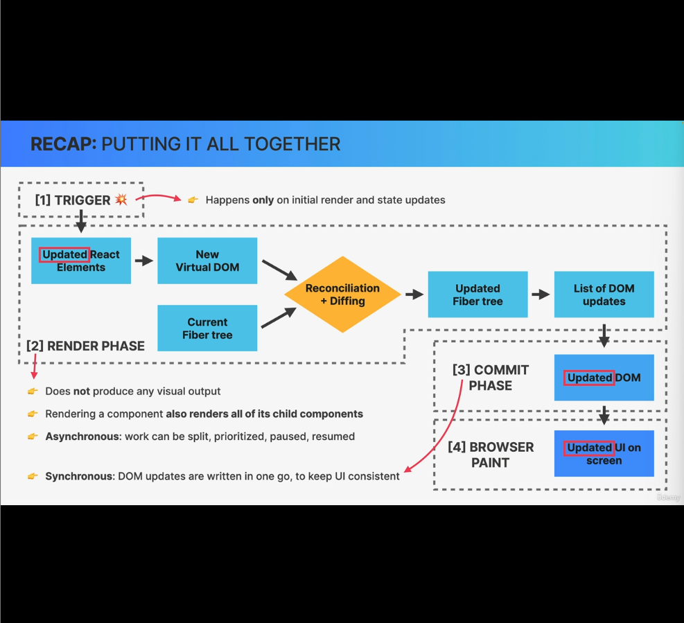

In last lecture we learned, render phase resulted in list of DOM updates, which is then fed to Commit phase.

### Step-3: Commit Phase:
- In this step, React finally writes to the DOM
    - Takes care of insertions, deletion and updation to the DOM
    - A list of DOM updates are flushed to the DOM.
        - Basically react goes throught the effects list that was created during rendering and applies them one by one to the actual DOM elements that were in the already existing DOM tree.

- Writing to the DOM, happens all in one go.
    - Commiting is synchronous and output of this step will reflect the changes directly in DOM.
    - This process can't be interrupted like render phase.
    - This unpaused behavior is neccessary so that the DOM never shows partial results, ensuring a consistent UI (in sync with state at all times).
    - In fact, that's the whole point of dividing the entire process into the render phase and the commit phase in first place, so that rendering can be paused, resumed or discarded and the result of all that rendering can then be flushed to the DOM in one go.

- Once the commit phase is completed, the workInProgress fiber tree becomes the current fiber tree for the next render cycle. That's because remember?, fiber trees are never discarded and never recreated from scratch. 
- Instead fiber trees are reused in order to save precious rendering time.
- This is the end of commit phase and now the browser will notice that DOM has been updated and as a result will repaint the screen whenever it has some idle time.

#### Who does what?
- Browser paint is ofcouse done by browser that is used by the user.
    ex: Chrome, Firefox, Safari or any other.
- Render phase is done by `react` npm package
- Who does the commit phase? Is it also done by `react`? Ans: No
    - Commit phase is the job of `react-dom` npm package, `ReactDOM` class.

Notes:
1. `react` doesnn't touch the DOM and has no idea where the output of render phase will go.
    - The reason for that is, `react` was designed to be used independently from the platform where the elements will actually be shown and therefore `react` is platform-independent and can be used at many hosts apart from Browsers.
2. What are the other hosts and their purpose:
    - ReactDOM - To build web apps using `react`
    - React Native - To build mobile & iOS apps, using `react`
    - Remotion - To build videos using `react`
    - Many more - To build word, pdf or figma or other docs

Note: *The list mentioned above are called renderers. Renderers don't render but commit the result of render phase.*

