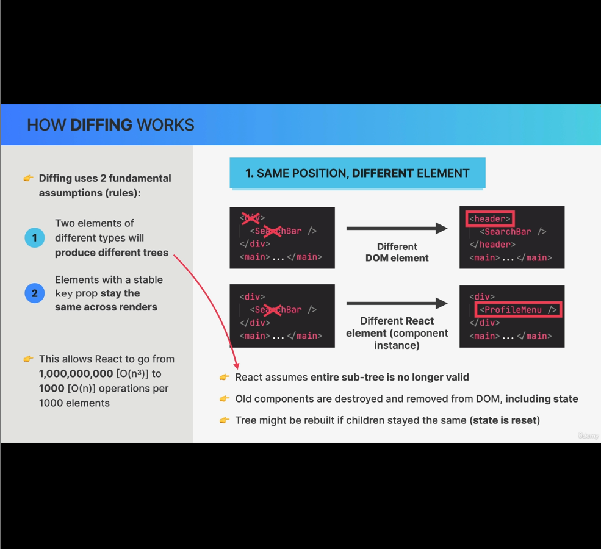
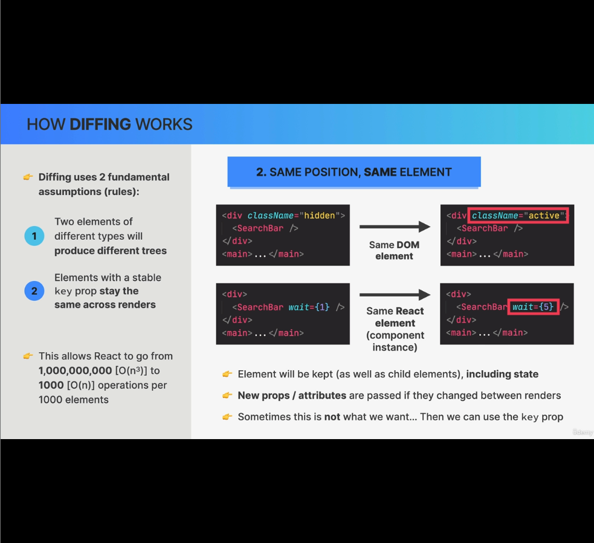

### How diffing works:

Diffing is built on 2 fundamental assumptions:
1. Two elements of different types will produce different trees
2. Elements with a stable key prop stay the same across renders

The above two principle allows React to go from O(n^3) to O(n).
For 1000 elements: It will be reduced from 1000,000,000 to 1000.

- Diffing is comapring elements step by step between two renders based on their position in the tree.
- There're basically three different situations that need to be considered:
    1. Same position, Different element
    2. Same position, Same element
    3. Different Position, Same element - (Discussed in Lecture 10: The Key props. Applicable majorly while rendering lists)

#### Scenario-1: Same position, Different element:
##### Scenario-1.1: Same Position, Different DOM element:

##### Scenario-1.2: Same Position, Different React element:
In both the scenarios 1.1 & 1.2:
1. React assumes entire sub-tree is no longer valid. and hence
2. Old components, including all its child components are destroyed and removed from DOM, including their state.
3. Tree might be rebuilt If children stayed the same(**state is reset**).

But in example code below, because of some state update, div is changed to header. Even though both header and div were wrapping Searchbar, the old SearchBar will be destroyed will all its state and a new SearchBar with default new state will be inserted.

#### Scenario-2: Same position, Same element:

##### Scenario-2.1: Same position, Same DOM element:

##### Scenario-2.2: Same position, Same React element:
In all Scenario 2:
1. Elements will be kept as well as child elements, including their state, even though the props is changed.
2. New props/attributes are passed If they changed between renders.
3. Sometimes this is not what we want and then we can use the key prop.

