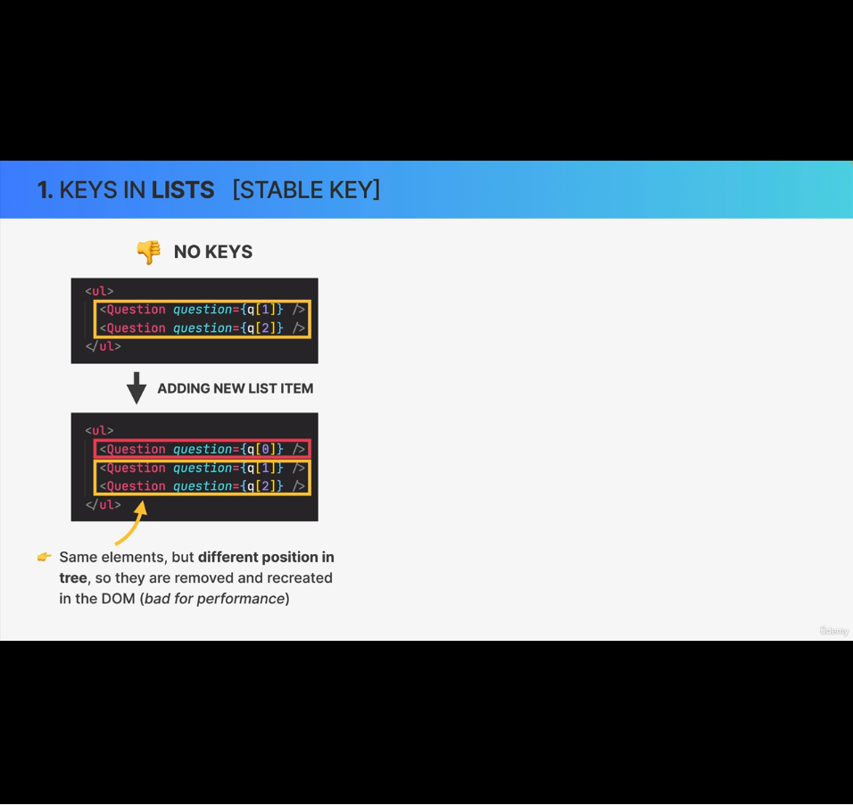
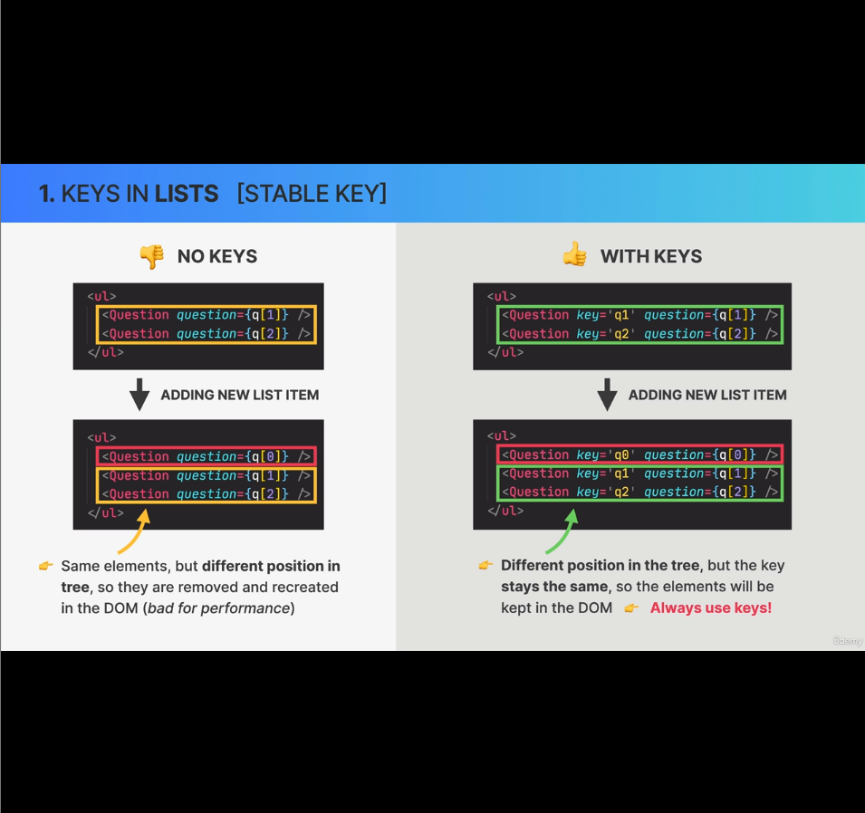
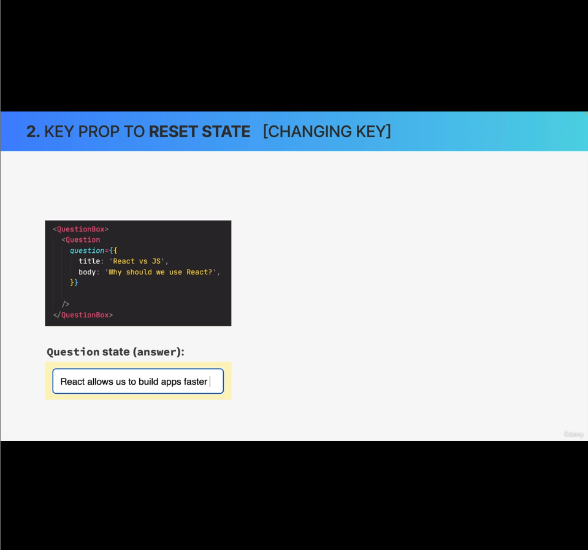
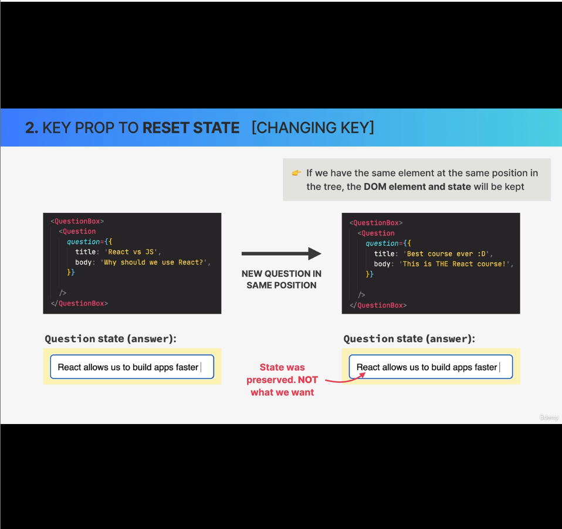
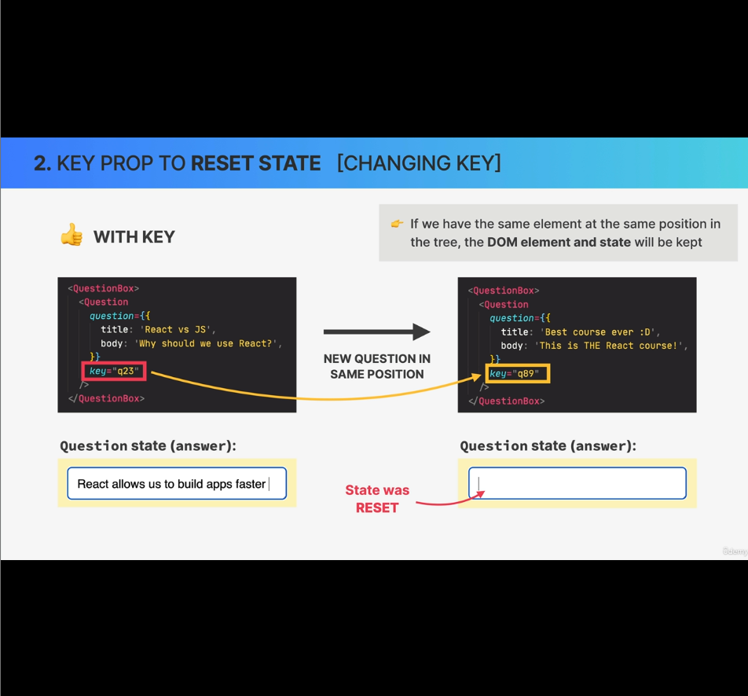
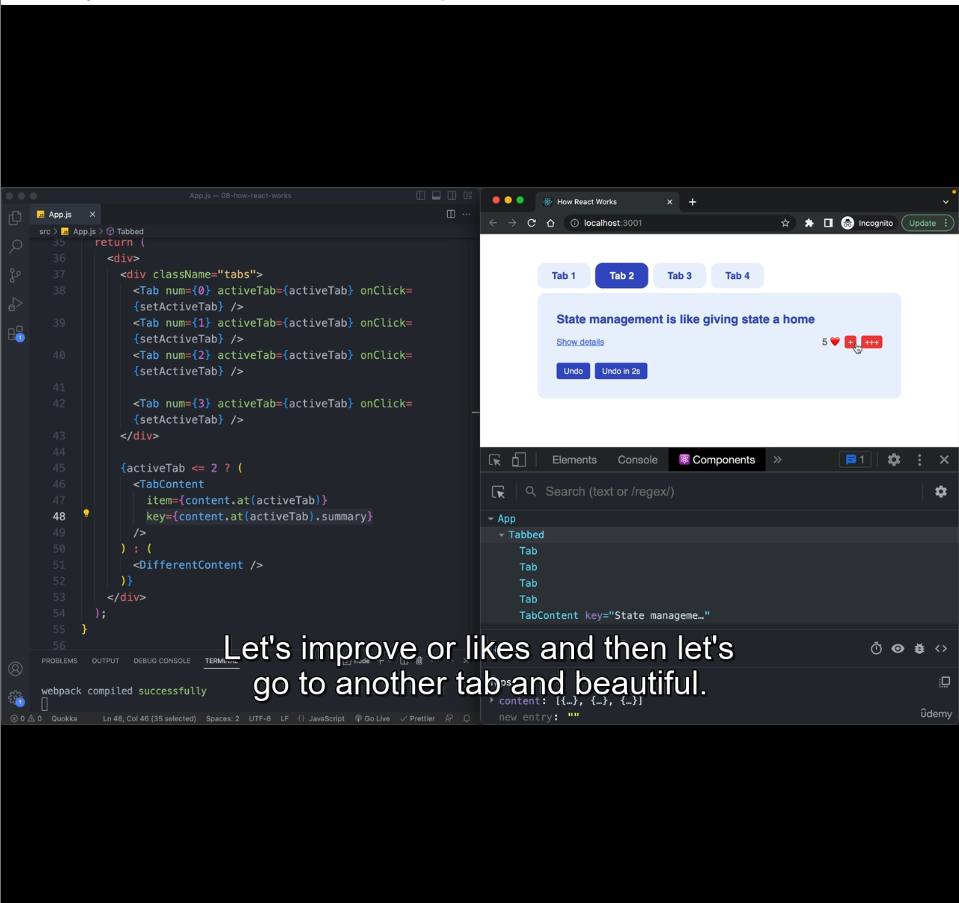

```
import { useState } from "react";

const content = [
  {
    summary: "React is a library for building UIs",
    details:
      "Dolor in reprehenderit in voluptate velit esse cillum dolore eu fugiat nulla pariatur. Occaecat cupidatat non proident, sunt in culpa qui officia deserunt mollit anim id est laborum.",
  },
  {
    summary: "State management is like giving state a home",
    details:
      "Lorem ipsum dolor sit amet, consectetur adipisicing elit, sed do eiusmod tempor incididunt ut labore et dolore magna aliqua. Excepteur sint occaecat cupidatat non proident, sunt in culpa qui officia deserunt mollit anim id est laborum.",
  },
  {
    summary: "We can think of props as the component API",
    details:
      "Ut enim ad minim veniam, quis nostrud exercitation ullamco laboris nisi ut aliquip ex ea commodo consequat. Duis aute irure dolor in reprehenderit in voluptate velit esse cillum dolore eu fugiat nulla pariatur.",
  },
];

export default function App() {
  return (
    <div>
      <Tabbed content={content} />
    </div>
  );
}

// console.log(<DifferentContent test={23} />);
// console.log(DifferentContent());

function Tabbed({ content }) {
  const [activeTab, setActiveTab] = useState(0);

  return (
    <div>
      <div className="tabs">
        <Tab num={0} activeTab={activeTab} onClick={setActiveTab} />
        <Tab num={1} activeTab={activeTab} onClick={setActiveTab} />
        <Tab num={2} activeTab={activeTab} onClick={setActiveTab} />

        <Tab num={3} activeTab={activeTab} onClick={setActiveTab} />
      </div>

      {activeTab <= 2 ? (
        <TabContent
          item={content.at(activeTab)}
          key={content.at(activeTab).summary}
        />
      ) : (
        <DifferentContent />
      )}
    </div>
  );
}

function Tab({ num, activeTab, onClick }) {
  return (
    <button
      className={activeTab === num ? "tab active" : "tab"}
      onClick={() => onClick(num)}
    >
      Tab {num + 1}
    </button>
  );
}

function TabContent({ item }) {
  const [showDetails, setShowDetails] = useState(true);
  const [likes, setLikes] = useState(0);

  console.log("RENDER");

  function handleInc() {
    setLikes((likes) => likes + 1);
  }

  function handleTripleInc() {
    // setLikes(likes + 1);
    // setLikes(likes + 1);
    // setLikes(likes + 1);

    setLikes((likes) => likes + 1);
    setLikes((likes) => likes + 1);
    setLikes((likes) => likes + 1);
  }

  function handleUndo() {
    setShowDetails(true);
    setLikes(0);
    console.log(likes);
  }

  function handleUndoLater() {
    setTimeout(handleUndo, 2000);
  }

  return (
    <div className="tab-content">
      <h4>{item.summary}</h4>
      {showDetails && <p>{item.details}</p>}

      <div className="tab-actions">
        <button onClick={() => setShowDetails((h) => !h)}>
          {showDetails ? "Hide" : "Show"} details
        </button>

        <div className="hearts-counter">
          <span>{likes} ❤️</span>
          <button onClick={handleInc}>+</button>
          <button onClick={handleTripleInc}>+++</button>
        </div>
      </div>

      <div className="tab-undo">
        <button onClick={handleUndo}>Undo</button>
        <button onClick={handleUndoLater}>Undo in 2s</button>
      </div>
    </div>
  );
}

function DifferentContent() {
  return (
    <div className="tab-content">
      <h4>I'm a DIFFERENT tab, so I reset state 💣💥</h4>
    </div>
  );
}
```

### Understanding diffing rules:
1. Same position, Different element will render the sub-tree and all components part of that sub-tree will be destroyed and rebuilt from scratch with default state.

In above code snippet, in `<TabContent/>` component we have two state variables:
1. showDetails: Decides whether to hide or show the tab content
2. likes: Shows the count of the likes for each tab content.

When user clicks on `Tab 1`, the `<TabContent />` component only receives the title and content as props. But the two states belongs to `<TabContent>` nad it controls the two states.

##### Observation with above code:

###### Scenario-1: 
1. 1. Click on Tab 1
2. Hide the details (`showDetails` will be false)
3. Click on like twice (`likes` will be 2)
4. Click on Tab 4, which will render the `<DifferentContent />`
5. Now click back on Tab 1. This time tab 1 will render with default state, i.e; Tab content will be shown (expanded, not collapsed) and likes also will show as 0.

###### Reason: The above happened becuase of the diffing rule, the React conciler follows; i.e; Same position, Different element between re-renders will reset the state. The old sub-tree will be destroyed.

###### Scenario-2: 
1. Click on Tab 1
2. Hide the details (`showDetails` will be false)
3. Click on like twice (`likes` will be 2)
4. Click on Tab 2
5. You'll see the tab title & content of Tab 2. But in Tab 2, content is hidden and like also shows 2, even though we're visiting Tab 2 for the first time.

###### Reason: The above happened becuase of the diffing rule, the React conciler follows, i.e; Same position, Same element-type will keep the element in DOM, and their state will be preserved.

Sometimes we don't want this behaviour(Scenario-2) and this can be changed using key props. Discussed in detail in next lecture.

----------

# Lecture 10. The Key Prop:

#### Expectations by end of Lecture-10: The Key props:
In lecture-8, we discussed about 2 fundamental assumptions that the diffing rule is based upon.
  1. Two elements of different types will produce different trees
    1. **Same position, Different element** - *Already discussed in lecture 8 & 9*
    2. **Same position, Same element** - *Already discussed in lecture 8 & 9*
    3. **Different Position, Same element** - *This will be discussed here in this lecture*
  2. Elements with a stable key prop stay the same across renders - *This will be discussed here in this lecture*
  

#### What is the key prop:
1. Special prop that we use to tell the diffing algorithm that an element is unique.
2. Allows React to distinguish between multiple instances of **same** component type.
  - When a key stays the **same across renders**, the element will be kept in the DOM (**even if the position in the tree changes**):
    - Usage: While rendering lists
  - When a key **changes between renders**, the element will be destroyed and a new one will be created (even if the position in the tree is the same as before)

Let's understand usage of keys through examples:
#### Example - 1. Keys in Lists (Stable Key):
Rule# 3: Different position and same element, can have two variations:
1. Not using keys
2. Using keys

##### 1.1 Not using keys:


In above snippet, at first there were two questions one with q[1] prop and other one with q[2] prop.

Later we added another new item with prop q[0], at the top of the list. In this case even though we've not modified anything to the component instance of `Question` with `q[1]` and `q[2]`, those two instances will also be re-rendered.

Because there's no way `React` could know that, these two are the same `Question` component instance, just the position in changed. So `React` will remove and recreate these in the DOM from scratch again, which is wasted work.

This can lead to bad performance.

##### 1.2 Using keys:


The problem we faced in 1.1 can be solved using keys.

So here, we added a unique key to each instance of `Question` component.

In the same example, when we added `question 0` later to the list, even though the position of `question 1 & 2` changed in DOM, the key remained same. This helped in `React` knowing that, it doesn't need to re-render the question 1 & 2, even though it's position is changed in DOM. 

In example 1 above we understood the behaviour when the key remains same between re-renders. Now let's understand the behaviour when the key changes between re-renders.

#### Example - 2. Keys prop to reset state (Changing Key):

Here we will get answer on how to solve scenario-2 of Lecture 9.



Let say we have a UI, where we show a question and below that question there's a input field for entering the answer. The answer input field will be empty at first.
User have to enter answer and click on next. Clicking next will show the next question and answer field will be empty again for the new question.

In the picture above, we can see, inside `QuestionBox` we render the `Question` component. And `Question` component takes the question as a prop. When user will click next, we will pass a diff prop to the `Question`.

Below that the answer is captured using a state variable managed by `Question`.

Let say user typed the answer `React allows us to build apps faster` and clicked next. Check below image, to know what will happen as per the diffing rules (Same position, Same element-type):


The answer input field is not empty and shows the same text entered for question1.

The behaviour we expected is to reset the answer input on clicking next, which can be acheived using keys.



In above image, when we passed different keys, to `Question` component, `React` is able to distinguish component instances of even same type. and it's able to render the new instance of `Question` with the default state.

# Lectuer 11 - Resetting State with the Key Prop:
We must be knowing the solution to the problem(Scenario-2) we faced in Lecture 9. So let's fix it by passing a changing key to the `TabContent`.

At 02:36 timestamp, we passed the summary of each tab as the key, as the summary is unique. (lin#48 in below image)


Observation:
In Tab 2. we increased the likes to 5, hide the content and switched to Tab 1. Then we saw Tab 1 is rendered with default state. but when we switched back to Tab 2 again, we see the state is lost. 

So everytime you click on a Tab it'll render from scratch. and to preserve the state of the components, we need to use redux or any state management libs, If you want react to remember the state of Tab2 when you switched back in this example.
